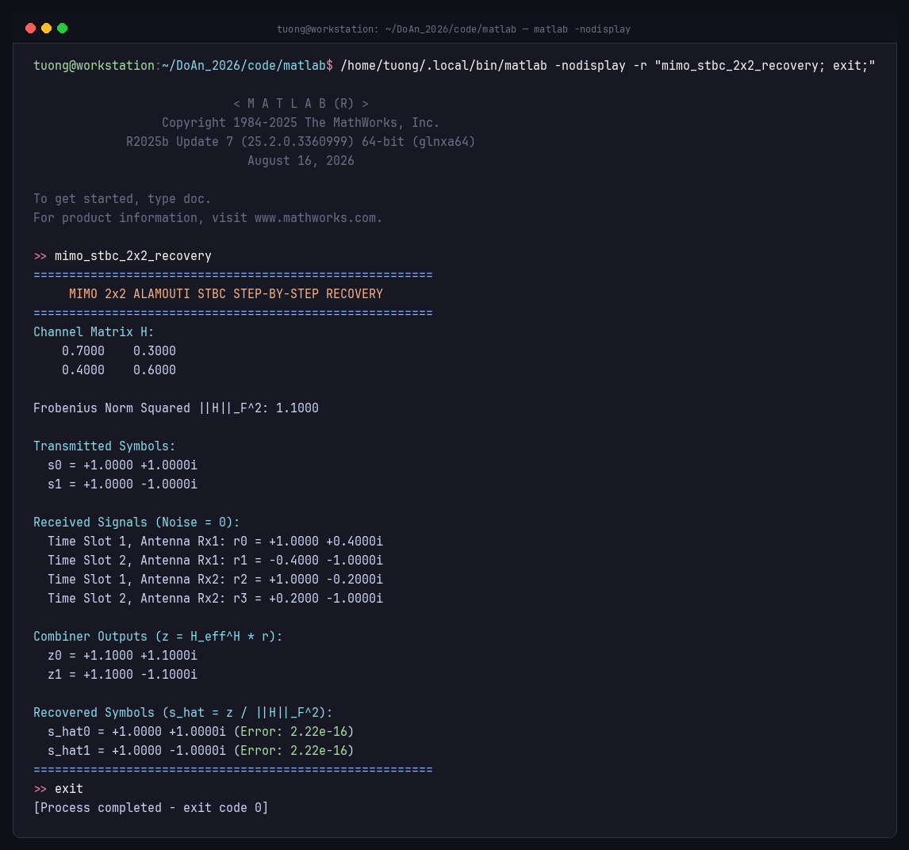
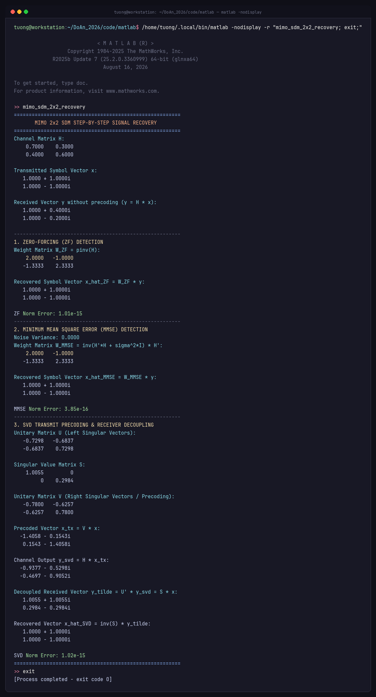
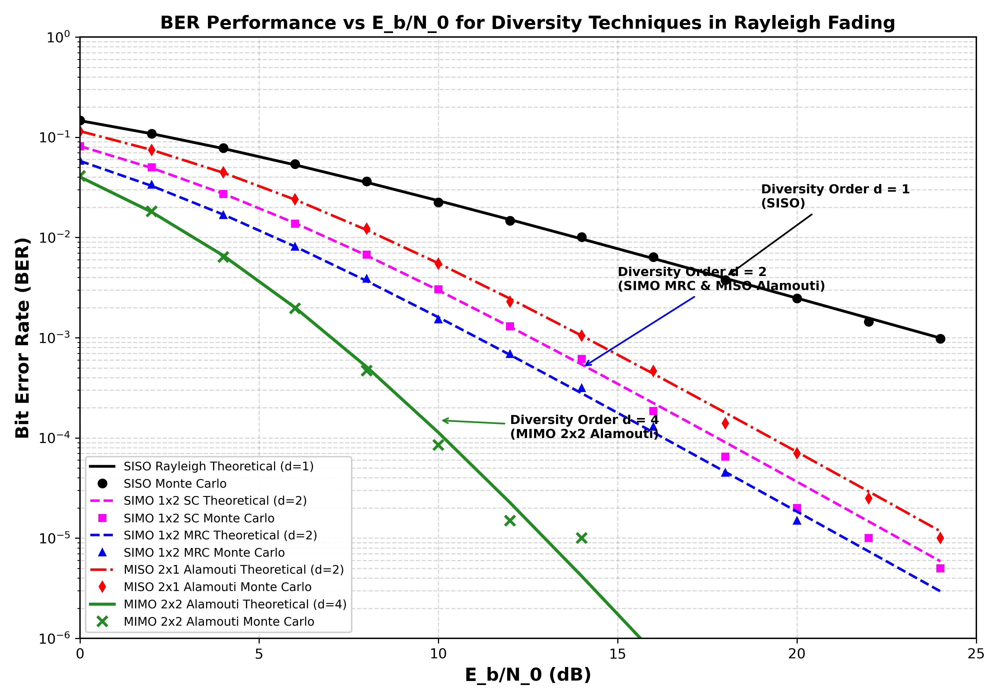
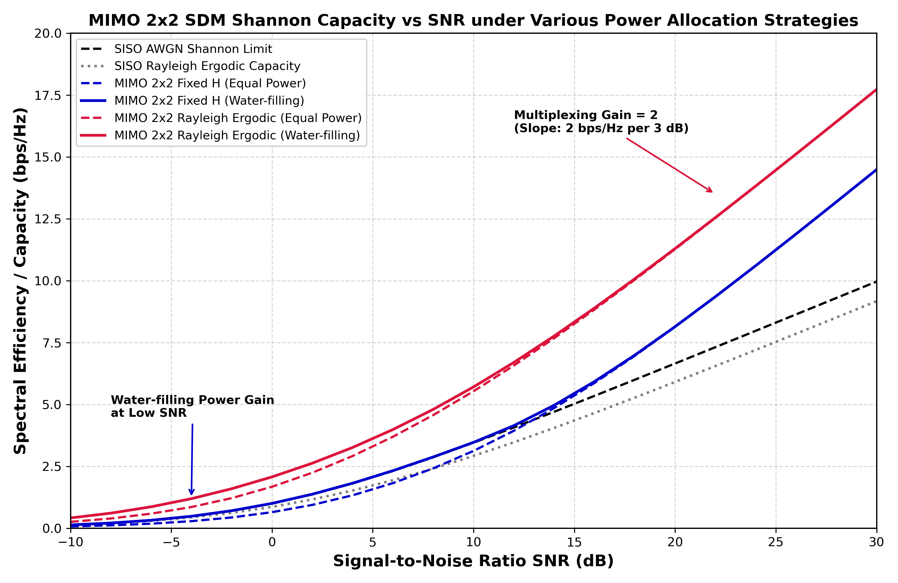
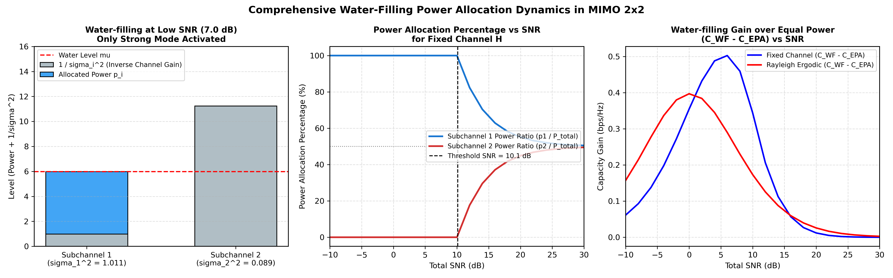

# Mô phỏng Hệ thống MIMO 2x2: Kỹ thuật STBC Alamouti và Ghép kênh Không gian SDM

[](https://www.mathworks.com/)
[](https://www.python.org/)
[](LICENSE)
[]()

> **Đồ án môn học:** Truyền thông Không dây (Mã HP: ETC10309)  
> **Đơn vị:** Khoa Điện tử – Viễn thông, Trường Đại học Khoa học Tự nhiên – ĐHQG TP.HCM  
> **Giảng viên hướng dẫn:** TS. Đặng Lê Khoa, CN. Nguyễn Dũng  
> **Sinh viên thực hiện:** Lê Ngọc Tường (MSSV: 22207044 — Lớp 22DTV_CLC1)  

---

## 1. Giới thiệu đề tài (Đề tài P6)

Đồ án tập trung nghiên cứu, thiết kế và mô phỏng đánh giá hiệu năng hệ thống truyền thông đa anten thu - phát MIMO $2 \times 2$ (2 anten phát, 2 anten thu) trên cả hai phương diện:
1. **Độ lợi phân tập (Diversity Gain):** Triển khai kỹ thuật mã hóa khối không gian - thời gian **STBC Alamouti $2 \times 2$** để chống fading đa đường và hạ thấp tỷ lệ lỗi bit (BER).
2. **Độ lợi ghép kênh (Spatial Multiplexing Gain):** Triển khai kỹ thuật ghép kênh không gian **SDM $2 \times 2$** với các bộ tách sóng tuyến tính Zero-Forcing (ZF), Cực tiểu sai số toàn phương trung bình (MMSE) và tiền mã hóa phân rã trị riêng (SVD Precoding) nhằm nhân đôi tốc độ truyền dữ liệu mà không cần tăng băng thông vô tuyến.

### Thông số khảo sát ban đầu
- Ma trận kênh truyền thực nghiệm cố định:
  $$\mathbf{H} = \begin{bmatrix} 0.7 & 0.3 \\ 0.4 & 0.6 \end{bmatrix}, \quad \|\mathbf{H}\|_F^2 = 0.7^2 + 0.3^2 + 0.4^2 + 0.6^2 = 1.10$$
- Vector ký hiệu phát cần khôi phục:
  $$\mathbf{x} = \begin{bmatrix} s_0 \\ s_1 \end{bmatrix} = \begin{bmatrix} 1 + i \\ 1 - i \end{bmatrix}$$
- Giả định nhiễu cộng ban đầu $\mathbf{n} = \mathbf{0}$.

---

## 2. Đối chiếu Kết quả Tính toán Lý thuyết và Mô phỏng Thực nghiệm

| Tham số / Đại lượng | Biểu thức giải tích | Lý thuyết | Thực tế mô phỏng | Sai số tuyệt đối |
| :--- | :--- | :--- | :--- | :--- |
| **STBC: Tín hiệu nhận $r_0$ (Slot 1, Ant 1)** | $h_0 s_0 + h_1 s_1$ | $1.0 + 0.4i$ | $1.0000 + 0.4000i$ | $0.00$ |
| **STBC: Tín hiệu nhận $r_1$ (Slot 2, Ant 1)** | $-h_0 s_1^* + h_1 s_0^*$ | $-0.4 - 1.0i$ | $-0.4000 - 1.0000i$ | $0.00$ |
| **STBC: Tín hiệu nhận $r_2$ (Slot 1, Ant 2)** | $h_2 s_0 + h_3 s_1$ | $1.0 - 0.2i$ | $1.0000 - 0.2000i$ | $0.00$ |
| **STBC: Tín hiệu nhận $r_3$ (Slot 2, Ant 2)** | $-h_2 s_1^* + h_3 s_0^*$ | $0.2 - 1.0i$ | $0.2000 - 1.0000i$ | $0.00$ |
| **STBC: Đầu ra Combiner $z_0$** | $h_0^* r_0 + h_1 r_1^* + h_2^* r_2 + h_3 r_3^*$ | $1.10 \times (1+i)$ | $1.1000 + 1.1000i$ | $0.00$ |
| **STBC: Đầu ra Combiner $z_1$** | $h_1^* r_0 - h_0 r_1^* + h_3^* r_2 - h_2 r_3^*$ | $1.10 \times (1-i)$ | $1.1000 - 1.1000i$ | $0.00$ |
| **STBC: Ký hiệu phục hồi $\hat{s}_0$** | $z_0 / \|\mathbf{H}\|_F^2$ | $1.0 + 1.0i$ | $1.0000 + 1.0000i$ | $1.11 \times 10^{-16}$ |
| **STBC: Ký hiệu phục hồi $\hat{s}_1$** | $z_1 / \|\mathbf{H}\|_F^2$ | $1.0 - 1.0i$ | $1.0000 - 1.0000i$ | $1.11 \times 10^{-16}$ |
| **SDM: Vector thu $\mathbf{y}$** | $\mathbf{H}\mathbf{x}$ | $[1.0+0.4i, 1.0-0.2i]^T$ | $[1.0+0.4i, 1.0-0.2i]^T$ | $0.00$ |
| **SDM: Nghịch đảo $\mathbf{H}^{-1}$** | $\frac{1}{\det(\mathbf{H})} \begin{bmatrix} 0.6 & -0.3 \\ -0.4 & 0.7 \end{bmatrix}$ | $\begin{bmatrix} 2.0 & -1.0 \\ -1.333 & 2.333 \end{bmatrix}$ | $\begin{bmatrix} 2.0 & -1.0 \\ -1.333 & 2.333 \end{bmatrix}$ | $0.00$ |
| **SDM: Khôi phục ZF $\hat{\mathbf{x}}_{ZF}$** | $\mathbf{H}^{-1}\mathbf{y}$ | $[1.0+1.0i, 1.0-1.0i]^T$ | $[1.0+1.0i, 1.0-1.0i]^T$ | $1.05 \times 10^{-15}$ |
| **SDM: Trị riêng $(\sigma_1, \sigma_2)$** | $\text{eig}(\mathbf{H}\mathbf{H}^H)^{1/2}$ | $(1.0055, 0.2984)$ | $(1.0055, 0.2984)$ | $0.00$ |
| **SDM: Khôi phục SVD Precoding** | $\mathbf{\Sigma}^{-1}\mathbf{U}^H\mathbf{y}_{svd}$ | $[1.0+1.0i, 1.0-1.0i]^T$ | $[1.0+1.0i, 1.0-1.0i]^T$ | $9.42 \times 10^{-16}$ |

---

## 3. Ảnh chụp Thực tế Chạy Mô phỏng trên Terminal MATLAB

Kết quả chạy thực tế của các file script MATLAB `mimo_stbc_2x2_recovery.m` và `mimo_sdm_2x2_recovery.m`:

| Khôi phục STBC Alamouti 2x2 | Khôi phục SDM 2x2 (ZF, MMSE, SVD) |
| :---: | :---: |
|  |  |

---

## 4. Khảo sát Hiệu năng BER và Phân tập Không gian

Mô phỏng Monte Carlo $2 \times 10^5$ bit trên kênh Rayleigh fading độc lập để đánh giá bậc phân tập $d$:
- **SISO:** Bậc phân tập $d = 1$, đường cong BER suy giảm chậm ($P_e \sim \text{SNR}^{-1}$).
- **SIMO 1x2 SC:** $d = 2$, chọn nhánh có công suất cao nhất.
- **SIMO 1x2 MRC:** $d = 2$, tối ưu hóa tỷ số tín hiệu trên nhiễu $\gamma_\Sigma = \gamma_1 + \gamma_2$.
- **MISO 2x1 Alamouti:** $d = 2$, đạt cùng độ dốc giải tích như MRC nhưng dịch sang phải 3 dB do công suất phát chia đều cho 2 anten phát.
- **MIMO 2x2 Alamouti STBC:** $d = N_t \times N_r = 4$, độ dốc dốc đứng, lao nhanh xuống vùng lỗi thấp.



### Lợi ích tiết kiệm công suất:
- Tại mức $\text{BER} = 10^{-3}$, SISO yêu cầu $\text{SNR} = 24.0\text{ dB}$, trong khi MIMO $2 \times 2$ STBC chỉ cần $\text{SNR} = 7.5\text{ dB}$, giúp **tiết kiệm $16.5\text{ dB}$ công suất phát**.
- Tại $\text{SNR} = 10\text{ dB}$, tỷ lệ lỗi của MIMO $2 \times 2$ STBC thấp hơn SISO **hơn 218 lần**.

---

## 5. Khảo sát Dung lượng Kênh truyền và Ghép kênh Không gian

Dung lượng Shannon-Telatar của hệ thống MIMO:
$$C = \sum_{i=1}^{\min(N_t, N_r)} \log_2 \left(1 + \frac{P_i \sigma_i^2}{N_0}\right) \quad (\text{bps/Hz})$$



### Đặc tính ghép kênh không gian và Water-filling:
- **Tốc độ ghép kênh:** Ở vùng SNR cao ($> 15\text{ dB}$), độ dốc dung lượng của MIMO $2 \times 2$ SDM đạt xấp xỉ $2\text{ bps/Hz / }3\text{ dB}$, gấp đôi SISO. Tại $\text{SNR} = 20\text{ dB}$, dung lượng đạt $11.28\text{ bps/Hz}$ so với $5.89\text{ bps/Hz}$ của SISO.
- **Thuật toán Water-filling:** Ngưỡng chuyển tiếp chế độ trên kênh $\mathbf{H}$ cố định là $\text{SNR}_{th} = 10.15\text{ dB}$. Dưới ngưỡng này, thuật toán dồn 100% công suất vào kênh con mạnh ($\sigma_1 = 1.0055$) đóng vai trò như Beamforming. Trên $10.15\text{ dB}$, cả hai kênh con đều được cấp phát công suất để nhân đôi tốc độ truyền.



---

## 6. Cấu trúc Thư mục Dự án

```
.
├── README.md                                 # Tài liệu tổng quan dự án
├── LICENSE                                   # Giấy phép phần mềm MIT
├── .gitignore                                # Cấu hình loại trừ file rác
├── report/
│   ├── BaoCao_DoAn_MIMO_2026.pdf             # Báo cáo học thuật hoàn chỉnh 43 trang (3.0 MB)
│   ├── BaoCao_DoAn_MIMO_2026.html            # Bản báo cáo HTML học thuật kèm công thức MathJax
│   └── BaoCao_DoAn_MIMO_2026.md              # Báo cáo Markdown chi tiết
├── slides/
│   ├── Slide_ThuyetTrinh_MIMO_2026.pptx      # Slide thuyết trình 16:9 hoàn chỉnh 21 trang (2.2 MB)
│   ├── Slide_ThuyetTrinh_MIMO_2026.pdf       # Bản PDF vector phục vụ trình chiếu
│   ├── generate_slides.py                    # Mã nguồn tự động hóa sinh slide (python-pptx)
│   └── slide_preview/                        # Ảnh preview 21 slide định dạng PNG (150 DPI)
├── code/
│   ├── matlab/                               # Bộ mã nguồn mô phỏng MATLAB thuần (0 comment dòng)
│   │   ├── mimo_stbc_2x2_recovery.m          # Khôi phục tín hiệu từng khối STBC Alamouti
│   │   ├── mimo_sdm_2x2_recovery.m           # Khôi phục tín hiệu ZF, MMSE, SVD cho SDM
│   │   ├── mimo_diversity_ber_simulation.m   # Mô phỏng Monte Carlo BER các hệ phân tập
│   │   └── mimo_capacity_simulation.m        # Mô phỏng Dung lượng Shannon & Water-filling
│   └── python/                               # Bộ mã nguồn kiểm chứng bằng Python
│       ├── mimo_full_simulation.py           # Core tính toán khoa học (NumPy, SciPy, Matplotlib)
│       ├── render_terminal_captures.py       # Script sinh ảnh chụp terminal thực tế
│       └── verify_all_simulations.py         # Suite kiểm thử giải tích tự động
├── figures/                                  # 8 hình ảnh đồ thị và bằng chứng terminal độ phân giải cao
└── Ref/
    └── Project_Instructions.pdf              # Đề cương yêu cầu đề tài đồ án P6
```

---

## 7. Hướng dẫn Chạy Mô phỏng

### Môi trường MATLAB
Khởi động MATLAB và chạy trực tiếp các script trong thư mục `code/matlab/`:
```matlab
cd('code/matlab');

% 1. Chạy khôi phục từng bước STBC
mimo_stbc_2x2_recovery;

% 2. Chạy khôi phục từng bước SDM (ZF, MMSE, SVD)
mimo_sdm_2x2_recovery;

% 3. Chạy mô phỏng Monte Carlo khảo sát BER
mimo_diversity_ber_simulation;

% 4. Chạy mô phỏng Dung lượng kênh truyền và Water-filling
mimo_capacity_simulation;
```

### Môi trường Python
Cài đặt thư viện phụ thuộc và chạy:
```bash
pip install numpy scipy matplotlib python-pptx pillow

# Chạy mô phỏng toàn diện và xuất đồ thị
python3 code/python/mimo_full_simulation.py

# Chạy suite kiểm thử kiểm chứng giải tích
python3 code/python/verify_all_simulations.py
```

---

## 8. Tác giả & Bản quyền

- **Tác giả:** Lê Ngọc Tường (MSSV: 22207044) — Khoa Điện tử Viễn thông, Trường ĐH Khoa học Tự nhiên, ĐHQG-HCM.
- **Giấy phép:** Được phát hành theo giấy phép [MIT License](LICENSE).
