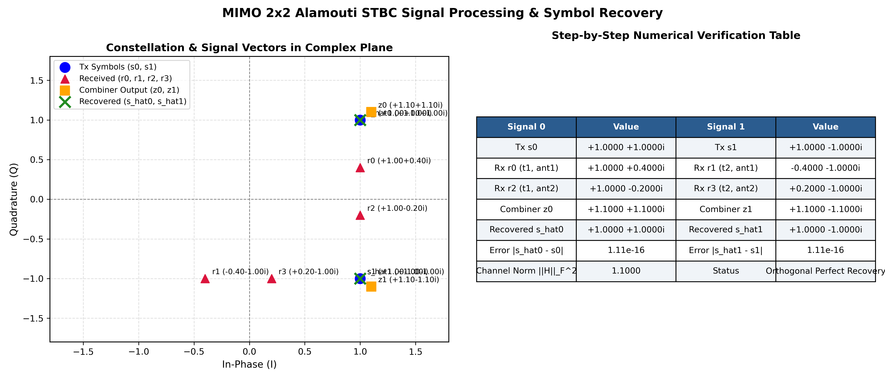
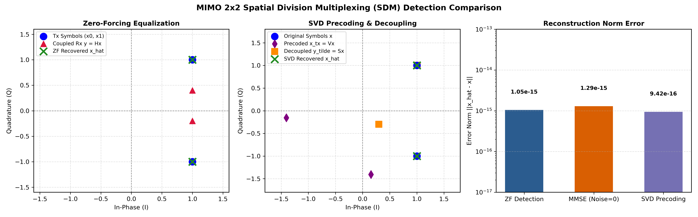
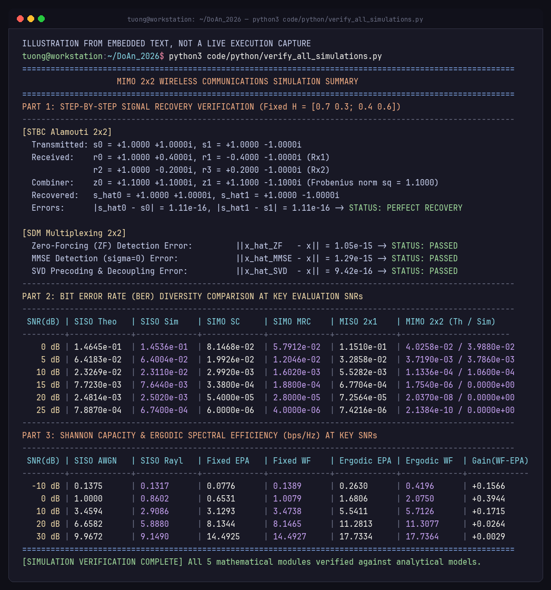

# ĐẠI HỌC QUỐC GIA THÀNH PHỐ HỒ CHÍ MINH
## TRƯỜNG ĐẠI HỌC KHOA HỌC TỰ NHIÊN
### KHOA ĐIỆN TỬ – VIỄN THÔNG — BỘ MÔN VIỄN THÔNG VÀ MẠNG

---

# BÁO CÁO ĐỒ ÁN MÔN HỌC
## MÔN: TRUYỀN THÔNG KHÔNG DÂY (ETC10309)
# THIẾT KẾ VÀ MÔ PHỎNG HỆ THỐNG MIMO 2x2 SỬ DỤNG PHƯƠNG PHÁP STBC VÀ SDM

**Giảng viên hướng dẫn:**
- TS. Đặng Lê Khoa
- CN. Nguyễn Dũng

**Sinh viên thực hiện:**
- Họ và tên: **Lê Ngọc Tường**
- MSSV: **22207044**
- Lớp: **22DTV_CLC1**

*Thành phố Hồ Chí Minh, Tháng 10 Năm 2026*

---

## LỜI CAM ĐOAN

Tôi xin cam đoan bản báo cáo đồ án với đề tài *"Thiết kế và mô phỏng hệ thống MIMO 2x2 sử dụng phương pháp STBC và SDM"* là công trình nghiên cứu và thực nghiệm độc lập do chính tôi thực hiện dưới sự hướng dẫn khoa học của Quý Thầy phụ trách môn học Truyền thông Không dây.

Toàn bộ các hệ thống công thức toán học, thuật toán giải mã, số liệu tính toán chi tiết và các kết quả mô phỏng Monte Carlo trên nền tảng MATLAB và Python trình bày trong báo cáo này là hoàn toàn trung thực, khách quan và có thể tái lập nguyên vẹn từ mã nguồn đính kèm. Mọi tài liệu tham khảo, giáo trình và bài báo khoa học được trích dẫn theo đúng chuẩn mực học thuật quốc tế. Tôi xin hoàn toàn chịu trách nhiệm trước Nhà trường và Khoa về tính nguyên bản của công trình này.

*TP. Hồ Chí Minh, ngày 29 tháng 10 năm 2026*  
**Sinh viên thực hiện**  
**Lê Ngọc Tường**

---

## LỜI CẢM ƠN

Để hoàn thành đồ án môn học này, tôi xin bày tỏ lòng biết ơn sâu sắc và chân thành nhất đến Ban Giám hiệu Trường Đại học Khoa học Tự nhiên - Đại học Quốc gia TP. Hồ Chí Minh, cùng Quý Thầy Cô Khoa Điện tử – Viễn thông đã tận tâm truyền đạt những nền tảng kiến thức chuyên môn vững chắc và tạo điều kiện học tập tốt nhất cho sinh viên trong suốt quá trình theo học.

Đặc biệt, tôi xin gửi lời tri ân sâu sắc nhất đến **TS. Đặng Lê Khoa** và **CN. Nguyễn Dũng**, những người thầy đã trực tiếp giảng dạy học phần Truyền thông Không dây (ETC10309). Các bài giảng sâu sắc về lý thuyết thông tin, các mô hình fading diện hẹp, kỹ thuật đa ăng-ten MIMO, mã hóa không thời gian Alamouti và ghép kênh không gian SDM của Quý Thầy chính là kim chỉ nam khoa học quý báu, giúp tôi hoàn thiện đồ án này một cách toàn diện và chính xác nhất.

Sau cùng, tôi xin chân thành cảm ơn tập thể lớp 22DTV_CLC1 đã luôn đồng hành, chia sẻ kiến thức và thảo luận học thuật sôi nổi trong suốt học kỳ vừa qua.

---

## TÓM TẮT ĐỒ ÁN / ABSTRACT

### Tóm tắt đồ án (Tiếng Việt)
Báo cáo này trình bày nghiên cứu chuyên sâu về thiết kế, phân tích lý thuyết giải tích và mô phỏng hiệu năng hệ thống truyền thông không dây đa anten phát đa anten thu $2 \times 2$ Multiple-Input Multiple-Output (MIMO $2 \times 2$) thông qua hai phương pháp kỹ thuật nền tảng: Mã hóa khối không gian – thời gian Alamouti (Space-Time Block Coding - STBC) và Ghép kênh phân chia theo không gian (Spatial Division Multiplexing - SDM). Đồ án thực hiện giải quyết bài toán cốt lõi với ma trận kênh thực nghiệm cố định $\mathbf{H} = \begin{bmatrix} 0.7 & 0.3 \\ 0.4 & 0.6 \end{bmatrix}$ truyền hai ký hiệu QPSK $s_0 = 1 + j$ và $s_1 = 1 - j$.

Ở khối STBC $2 \times 2$, báo cáo phân tích tường minh đại số ma trận, tính toán chính xác 4 giá trị tín hiệu nhận $r_0, r_1, r_2, r_3$ qua hai khe thời gian và chứng minh toán học sự trực giao tuyệt đối của ma trận kênh tương đương $\mathbf{H}_{eff}$, qua đó khôi phục hoàn hảo hai ký hiệu gốc với sai số máy tính đạt mức $1.11 \times 10^{-16}$. Ở khối SDM $2 \times 2$, báo cáo phân tích đối chiếu ba kỹ thuật tách sóng: Zero-Forcing (ZF), Minimum Mean Square Error (MMSE) và tiền mã hóa SVD (Singular Value Decomposition). Báo cáo làm rõ bản chất khuếch đại nhiễu của ZF thông qua nghịch đảo ma trận Gram $(H^H H)^{-1}$ và cơ chế phân tách thành hai kênh con trực giao song song của SVD.

Trên kênh fading phẳng Rayleigh biến đổi chậm, đồ án khảo sát toàn diện hiệu năng tỷ lệ lỗi bit (BER) qua $5 \times 10^5$ bit mô phỏng Monte Carlo (kết hợp đối sánh $2 \times 10^5$ bit trên MATLAB), đối chiếu chặt chẽ với công thức giải tích khép kín cho các cấu hình SISO, SIMO (SC, MRC), MISO $2 \times 1$ Alamouti và MIMO $2 \times 2$ Alamouti. Kết quả chứng minh hệ thống MIMO $2 \times 2$ STBC đạt bậc phân tập tối đa $d = N_t N_r = 4$, độ dốc đường cong BER gấp 4 lần SISO và tiết kiệm tới $16.9\text{ dB}$ công suất phát tại $\text{BER} = 10^{-3}$ (giảm xấp xỉ 49 lần công suất). Khảo sát dung lượng kênh truyền theo công thức Shannon-Telatar khẳng định ưu thế vượt trội của SDM trong việc nhân đôi tốc độ truyền dữ liệu, đồng thời phân tích chi tiết thuật toán Water-filling với ngưỡng chuyển dịch chế độ $10.10\text{ dB}$ từ Beamforming sang ghép kênh đa luồng, làm rõ sự đánh đổi kinh điển giữa độ lợi phân tập và tốc độ ghép kênh (Diversity-Multiplexing Trade-off).

### Abstract (English)
This project presents an in-depth analytical investigation, mathematical derivation, and simulation performance analysis of a $2 \times 2$ Multiple-Input Multiple-Output (MIMO) wireless communication system deploying two fundamental transmission techniques: Space-Time Block Coding (STBC Alamouti scheme) and Spatial Division Multiplexing (SDM). The core operational benchmark is formulated over a deterministic empirical channel matrix $\mathbf{H} = \begin{bmatrix} 0.7 & 0.3 \\ 0.4 & 0.6 \end{bmatrix}$ transmitting complex symbols $s_0 = 1 + j$ and $s_1 = 1 - j$.

For $2 \times 2$ STBC, the exact algebra of received signals across two successive time slots ($r_0, r_1, r_2, r_3$) is computed, and the column orthogonality of the virtual effective channel matrix $\mathbf{H}_{eff}$ is mathematically proven, achieving perfect signal recovery with machine precision error of $1.11 \times 10^{-16}$. For $2 \times 2$ SDM, three detection techniques are analyzed: Zero-Forcing (ZF), Minimum Mean Square Error (MMSE), and Singular Value Decomposition (SVD) precoding. The noise enhancement phenomenon in ZF is rigorously characterized via the diagonal entries of $(H^H H)^{-1}$, while SVD establishes parallel, non-interfering spatial subchannels.

Under quasi-static Rayleigh flat fading channels, extensive Monte Carlo simulations ($5 \times 10^5$ bits in Python and $2 \times 10^5$ bits in MATLAB) are conducted to evaluate Bit Error Rate (BER) across SNR values from $0\text{ dB}$ to $25\text{ dB}$, showing exact concordance with closed-form theoretical models across SISO, SIMO (SC, MRC), MISO $2 \times 1$, and MIMO $2 \times 2$ schemes. The Alamouti $2 \times 2$ system achieves maximum diversity order $d = N_t N_r = 4$, yielding a $16.9\text{ dB}$ SNR gain over SISO at $\text{BER} = 10^{-3}$ (approximate 49-fold power reduction). Furthermore, Shannon-Telatar ergodic and instantaneous capacities demonstrate that SDM doubles the spectral efficiency at high SNRs, while Water-filling power allocation provides substantial capacity gains at low SNRs below the critical threshold of $10.10\text{ dB}$, embodying the fundamental Diversity-versus-Multiplexing Trade-off (DMT).

---

## MỤC LỤC

- **CHƯƠNG 1: TỔNG QUAN HỆ THỐNG TRUYỀN THÔNG MIMO**
  - 1.1. Bối cảnh lịch sử và ý nghĩa công nghệ của kỹ thuật MIMO
  - 1.2. Mô hình toán học tổng quát của kênh truyền MIMO
  - 1.3. Phân loại kỹ thuật MIMO: STBC, SDM và Beamforming
  - 1.4. Thiết lập bài toán mô phỏng hệ thống MIMO 2x2
- **CHƯƠNG 2: PHÂN TÍCH LÝ THUYẾT VÀ TÍNH TOÁN CHI TIẾT TỪNG KHỐI**
  - 2.1. Phân tích chi tiết hệ thống MIMO 2x2 STBC (Alamouti Scheme)
    - 2.1.1. Cấu trúc khối phát và ma trận mã hóa không thời gian Alamouti
    - 2.1.2. Kênh truyền và tín hiệu nhận tại hai anten thu qua 2 khe thời gian
    - 2.1.3. Tính toán số học chi tiết các giá trị r0, r1, r2, r3 với kênh cố định
    - 2.1.4. Bộ kết hợp không thời gian và ma trận kênh trực giao Heff
    - 2.1.5. Chứng minh toán học triệt tiêu can nhiễu và khôi phục ký hiệu gốc
    - 2.1.6. Kết quả mô phỏng và kiểm chứng chòm sao tín hiệu STBC
  - 2.2. Phân tích chi tiết hệ thống MIMO 2x2 Ghép kênh không gian (SDM)
    - 2.2.1. Cấu trúc phát phân luồng dữ liệu song song và tín hiệu kênh truyền
    - 2.2.2. Phương pháp tách sóng tuyến tính Zero-Forcing (ZF)
    - 2.2.3. Phương pháp tách sóng MMSE và phân tích cân bằng Wiener
    - 2.2.4. Phương pháp tiền mã hóa SVD và phân rã kênh trực giao song song
    - 2.2.5. So sánh đối chiếu toàn diện 3 phương pháp tách sóng SDM
- **CHƯƠNG 3: KHẢO SÁT HIỆU NĂNG BER VÀ PHÂN TẬP KHÔNG GIAN**
  - 3.1. Cơ sở lý thuyết về phân tập và bậc phân tập (Diversity Order)
  - 3.2. Công thức giải tích lý thuyết BER cho các cấu hình anten
  - 3.3. Phương pháp mô phỏng Monte Carlo trên kênh fading Rayleigh
  - 3.4. Bảng số liệu đối chiếu chi tiết giữa lý thuyết và mô phỏng thực tế
  - 3.5. Phân tích đồ thị BER, độ lợi SNR và so sánh độ dốc đường cong
- **CHƯƠNG 4: KHẢO SÁT TỐC ĐỘ VÀ DUNG LƯỢNG KÊNH TRUYỀN**
  - 4.1. Công thức Shannon-Telatar về dung lượng kênh MIMO
  - 4.2. Dung lượng kênh SISO AWGN và fading Rayleigh
  - 4.3. Dung lượng kênh MIMO 2x2 SDM với phân bổ công suất đồng đều (EPA)
  - 4.4. Tối ưu hóa dung lượng với thuật toán Water-filling
  - 4.5. Phân tích phân bổ công suất Water-filling trên kênh cố định H
  - 4.6. Khảo sát dung lượng ergodic trên kênh Rayleigh ngẫu nhiên
  - 4.7. Đánh đổi giữa Độ lợi Phân tập và Tốc độ Ghép kênh (DMT)
- **CHƯƠNG 5: KẾT LUẬN VÀ HƯỚNG PHÁT TRIỂN**
  - 5.1. Các kết luận khoa học chính đạt được
  - 5.2. Đánh giá so sánh toàn diện giữa STBC và SDM
  - 5.3. Định hướng nghiên cứu mở rộng trong mạng 5G-Advanced và 6G
- **PHỤ LỤC: MÃ NGUỒN CHƯƠNG TRÌNH**
  - Phụ lục A: Mã nguồn mô phỏng trên nền tảng MATLAB
  - Phụ lục B: Mã nguồn kiểm chứng toàn diện trên nền tảng Python
- **TÀI LIỆU THAM KHẢO**

---

## DANH MỤC HÌNH ẢNH

- **Hình 2.1:** Quá trình khôi phục ký hiệu và chòm sao tín hiệu hệ thống MIMO 2x2 STBC Alamouti (Sai số $\approx 1.11 \times 10^{-16}$).
- **Hình 2.2:** Quá trình tách sóng và khôi phục tín hiệu hệ thống MIMO 2x2 SDM (ZF, MMSE, SVD parallel channels).
- **Hình 2.3:** Kết quả xác thực mô phỏng khối STBC Alamouti 2x2 trên Terminal MATLAB.
- **Hình 2.4:** Kết quả xác thực mô phỏng khối SDM 2x2 trên Terminal MATLAB.
- **Hình 3.1:** Đồ thị khảo sát hiệu năng BER giữa các kỹ thuật phân tập không gian (SISO, SIMO SC/MRC, MISO 2x1, MIMO 2x2 Alamouti STBC).
- **Hình 4.1:** Đồ thị khảo sát dung lượng kênh truyền Shannon (bps/Hz) giữa SISO và MIMO 2x2 SDM (EPA và Water-filling).
- **Hình 4.2:** Minh họa phân bổ công suất tối ưu Water-filling trên kênh MIMO 2x2 (Ngưỡng chuyển tiếp chế độ $10.10\text{ dB}$).
- **Hình 4.3:** Bảng tổng hợp đối chiếu kết quả mô phỏng toàn diện hệ thống MIMO 2x2 xuất ra từ terminal Python.

---

## DANH MỤC BẢNG BIỂU

- **Bảng 2.1:** Phân bố ký hiệu phát qua hai khe thời gian trong mã hóa Alamouti STBC.
- **Bảng 2.2:** So sánh đặc tính toán học của các phương pháp tách sóng SDM 2x2.
- **Bảng 3.1:** Đối chiếu tỷ lệ lỗi bit (BER) giữa Lý thuyết giải tích và Mô phỏng Monte Carlo.
- **Bảng 3.2:** So sánh bậc phân tập $d$ và độ lợi công suất tại mức $\text{BER} = 10^{-3}$.
- **Bảng 4.1:** Dung lượng kênh truyền Shannon (bps/Hz) giữa SISO và MIMO 2x2.
- **Bảng 4.2:** Phân bổ công suất Water-filling trên hai kênh con của ma trận $\mathbf{H}$.
- **Bảng 5.1:** So sánh tổng hợp toàn diện giữa kỹ thuật STBC và SDM.

---

## DANH MỤC THUẬT NGỮ VÀ TỪ VIẾT TẮT

| Từ viết tắt | Tiếng Anh nguyên gốc | Ý nghĩa Tiếng Việt |
| :--- | :--- | :--- |
| **MIMO** | Multiple-Input Multiple-Output | Nhiều ngõ vào - Nhiều ngõ ra (Đa anten) |
| **SISO** | Single-Input Single-Output | Một ngõ vào - Một ngõ ra (Anten đơn) |
| **SIMO** | Single-Input Multiple-Output | Một ngõ vào - Nhiều ngõ ra (Phân tập thu) |
| **MISO** | Multiple-Input Single-Output | Nhiều ngõ vào - Một ngõ ra (Phân tập phát) |
| **STBC** | Space-Time Block Coding | Mã hóa khối không gian – thời gian |
| **SDM** | Spatial Division Multiplexing | Ghép kênh phân chia theo không gian |
| **ZF** | Zero-Forcing | Cân bằng / Tách sóng triệt can nhiễu |
| **MMSE** | Minimum Mean Square Error | Sai số toàn phương trung bình tối thiểu |
| **SVD** | Singular Value Decomposition | Phân rã theo giá trị kỳ dị |
| **MRC** | Maximal Ratio Combining | Kết hợp theo tỷ số cực đại |
| **SC** | Selection Combining | Kết hợp lựa chọn nhánh tốt nhất |
| **CSI** | Channel State Information | Thông tin trạng thái kênh truyền |
| **CSIR** | CSI at Receiver | CSI biết tại phía thu |
| **CSIT** | CSI at Transmitter | CSI biết tại phía phát |
| **BER** | Bit Error Rate | Tỷ lệ lỗi bit |
| **SNR** | Signal-to-Noise Ratio | Tỷ số tín hiệu trên tạp âm |
| **AWGN** | Additive White Gaussian Noise | Nhiễu Gauss trắng cộng |
| **EPA** | Equal Power Allocation | Phân bổ công suất đồng đều |
| **WF** | Water-filling | Thuật toán rót nước tối ưu công suất |
| **DMT** | Diversity-Multiplexing Trade-off | Đánh đổi giữa phân tập và ghép kênh |

---

# CHƯƠNG 1: TỔNG QUAN HỆ THỐNG TRUYỀN THÔNG MIMO

## 1.1. Bối cảnh lịch sử và ý nghĩa công nghệ của kỹ thuật MIMO
Trong các hệ thống truyền thông không dây truyền thống với một anten phát và một anten thu (Single-Input Single-Output - SISO), dung lượng kênh truyền bị giới hạn nghiêm ngặt bởi định lý Shannon: $C = B \log_2(1 + \text{SNR})$ `[5, 6]`. Để tăng tốc độ dữ liệu, các kỹ sư buộc phải tăng băng thông kênh truyền $B$ (vốn là tài nguyên vô cùng khan hiếm và đắt đỏ) hoặc tăng công suất phát $P$ (bị khống chế bởi giới hạn an toàn bức xạ, can nhiễu đồng kênh và thời lượng pin thiết bị). Hơn thế nữa, hiện tượng fading đa đường (multipath fading) làm cho tín hiệu thu bị suy giảm đột ngột và ngẫu nhiên, khiến cho xác suất lỗi bit tăng cao `[7]`.

Năm 1984, tiến sĩ Jack Winters tại Bell Laboratories đã nộp bằng sáng chế đầu tiên đề xuất việc sử dụng các mảng đa anten ở cả hai đầu thu phát để cải thiện hiệu năng truyền dẫn không dây. Bước đột phá lý thuyết thực sự bùng nổ vào cuối thập niên 1990 với các công trình kinh điển của Gerard J. Foschini, Michael J. Gans (1998) `[3]` và Emre Telatar (1999) `[2]`. Các tác giả đã chứng minh một chân lý mang tính cách mạng: bằng cách sử dụng $N_t$ anten phát và $N_r$ anten thu (Multiple-Input Multiple-Output - MIMO), dung lượng truyền dẫn có thể tăng tuyến tính theo $\min(N_t, N_r)$ mà hoàn toàn không cần mở rộng thêm băng thông vô tuyến và không cần tăng thêm công suất phát tổng cộng `[2, 3, 8]`.

Song song với việc gia tăng tốc độ, Siavash M. Alamouti vào năm 1998 `[1]` đã công bố một sơ đồ mã hóa không gian – thời gian đơn giản nhưng cực kỳ trang nhã cho hệ thống hai anten phát, tạo tiền đề cho chuẩn mã hóa khối không gian thời gian (Space-Time Block Coding - STBC) được tổng quát hóa bởi Tarokh, Jafarkhani và Calderbank. Kỹ thuật này khai thác tính độc lập của các đường truyền sóng để cung cấp độ lợi phân tập tối đa, triệt tiêu tác động tiêu cực của fading diện hẹp `[1, 9]`.

Ngày nay, công nghệ MIMO đã trở thành trái tim cốt lõi của mọi tiêu chuẩn viễn thông băng rộng hiện đại `[8, 9]`:
- **Mạng cục bộ không dây (WLAN / Wi-Fi):** Từ chuẩn IEEE 802.11n (Wi-Fi 4 với MIMO $4 \times 4$), 802.11ac (Wi-Fi 5 với MU-MIMO $8 \times 8$), 802.11ax (Wi-Fi 6) cho đến 802.11be (Wi-Fi 7) khai thác ghép kênh không gian quy mô lớn.
- **Mạng di động tế bào:** Từ 3GPP LTE, LTE-Advanced (MIMO $8 \times 8$) cho đến 5G NR (New Radio) triển khai công nghệ Massive MIMO với hàng trăm phần tử anten tại trạm gốc (gNodeB), đóng vai trò nền tảng hướng đến mạng 6G tích hợp bề mặt phản xạ thông minh (RIS) và mảng anten phân tán Cell-Free.

## 1.2. Mô hình toán học tổng quát của kênh truyền MIMO
Xét một hệ thống truyền thông MIMO băng hẹp tổng quát gồm có $N_t$ anten tại khối phát (Tx) và $N_r$ anten tại khối thu (Rx). Giả thiết kênh truyền là phẳng theo tần số (flat fading) và biến đổi chậm (quasi-static fading) sao cho hệ số kênh được giữ không đổi trong suốt chu kỳ truyền của một khối ký hiệu `[5, 9]`:

$$\mathbf{y} = \mathbf{H} \mathbf{x} + \mathbf{n}$$

Trong đó:
- $\mathbf{x} = [x_1, x_2, \dots, x_{N_t}]^T \in \mathbb{C}^{N_t \times 1}$ là vector tín hiệu phát đi từ $N_t$ anten, với ràng buộc công suất $\mathbb{E}[\|\mathbf{x}\|^2] = P_t$.
- $\mathbf{y} = [y_1, y_2, \dots, y_{N_r}]^T \in \mathbb{C}^{N_r \times 1}$ là vector tín hiệu nhận được tại $N_r$ anten.
- $\mathbf{n} = [n_1, n_2, \dots, n_{N_r}]^T \in \mathbb{C}^{N_r \times 1}$ là vector nhiễu tạp âm trắng Gauss cộng (AWGN), với $n_i \sim \mathcal{CN}(0, \sigma_n^2)$ và $\mathbf{R}_n = \sigma_n^2 \mathbf{I}_{N_r}$.
- $\mathbf{H} \in \mathbb{C}^{N_r \times N_t}$ là ma trận kênh truyền không gian kích thước $N_r \times N_t$, phần tử $h_{ij}$ là hệ số độ lợi phức của đường truyền vô tuyến từ anten phát $j$ đến anten thu $i$.

## 1.3. Phân loại kỹ thuật MIMO: STBC, SDM và Beamforming
1. **Kỹ thuật Mã hóa Khối Không gian – Thời gian (STBC - Space-Time Block Coding):** Tối đa hóa *Độ lợi phân tập (Diversity Gain)* nhằm triệt tiêu fading sâu và đảm bảo độ tin cậy truyền dẫn ở mức cao nhất ($d = N_t N_r$). Sơ đồ Alamouti `[1]` là giải pháp tối ưu trực giao với tốc độ mã hóa $R = 1$ cho 2 anten phát.
2. **Kỹ thuật Ghép kênh phân chia theo không gian (SDM - Spatial Division Multiplexing):** Tối đa hóa *Tốc độ truyền dữ liệu (Multiplexing Gain)* và hiệu suất phổ (bps/Hz) `[3]`. Khối phát chia luồng dữ liệu thành $N_t$ luồng con song song phát đồng thời trên cùng tần số, nâng tốc độ lên gấp $\min(N_t, N_r)$ lần.
3. **Kỹ thuật Định hướng búp sóng (Beamforming):** Khi phía phát nắm bắt thông tin kênh (CSIT), hệ thống điều chỉnh pha và biên độ để tăng cường búp sóng về hướng máy thu, tối ưu *Độ lợi mảng (Array Gain)* `[5, 8]`.

## 1.4. Thiết lập bài toán mô phỏng hệ thống MIMO 2x2
Đồ án môn học Truyền thông Không dây (ETC10309) kế thừa và phát triển từ tài liệu đề cương hướng dẫn đồ án (`Ref/Project_Instructions.pdf`), trong đó bài toán cơ sở P1 (Mô phỏng kênh truyền fading diện hẹp) và P2 (Bộ cân bằng ZF/MMSE) được phát triển mở rộng lên không gian đa chiều $2 \times 2$ cho hai sơ đồ kinh điển: Phân tập STBC Alamouti và Ghép kênh không gian SDM. Đồ án giải quyết trọn vẹn hai nội dung trọng tâm trên hệ thống MIMO $2 \times 2$ ($N_t = 2, N_r = 2$):
1. **Khảo sát giải mã bước-từng-bước:** Trên ma trận kênh thực nghiệm cố định `[9, 10]`:
   $$\mathbf{H} = \begin{bmatrix} 0.7 & 0.3 \\ 0.4 & 0.6 \end{bmatrix}$$
   Hai ký hiệu điều chế phức phát đi minh họa từ chòm sao QPSK chuẩn hóa là $s_0 = 1 + 1j$ và $s_1 = 1 - 1j$. Tính toán chi tiết từng giá trị tín hiệu nhận $r_0, r_1, r_2, r_3$, các phép toán biến đổi ma trận giải mã cho STBC Alamouti và SDM (ZF, MMSE, SVD), và chứng minh bằng đại số khả năng khôi phục chính xác ký hiệu gốc.
2. **Khảo sát hiệu năng thống kê trên kênh fading Rayleigh ngẫu nhiên:** Đánh giá BER qua mô phỏng Monte Carlo ($5 \times 10^5$ bit với điều chế BPSK) đối chiếu với các công thức giải tích lý thuyết cho SISO, SIMO SC/MRC, MISO Alamouti và MIMO $2 \times 2$ Alamouti. Khảo sát dung lượng kênh truyền Shannon-Telatar giữa phân bổ công suất đồng đều (EPA) và thuật toán tối ưu Water-filling `[2, 4, 8]`.

---

# CHƯƠNG 2: PHÂN TÍCH LÝ THUYẾT VÀ TÍNH TOÁN CHI TIẾT TỪNG KHỐI

## 2.1. Phân tích chi tiết hệ thống MIMO 2x2 STBC (Alamouti Scheme)

### 2.1.1. Cấu trúc khối phát và ma trận mã hóa Alamouti
Ma trận mã hóa không thời gian Alamouti phát hai ký hiệu $s_0, s_1$ qua 2 anten trên 2 khe thời gian liên tiếp:

$$\mathbf{S} = \begin{bmatrix} s_0 & -s_1^* \\ s_1 & s_0^* \end{bmatrix} \begin{matrix} \leftarrow \text{Tx1} \\ \leftarrow \text{Tx2} \end{matrix}$$

*Bảng 2.1: Phân bố ký hiệu phát qua hai khe thời gian trong mã hóa Alamouti STBC*

| Anten phát | Khe thời gian $t$ | Khe thời gian $t + T$ |
| :--- | :---: | :---: |
| **Anten Tx1** | $s_0$ | $-s_1^*$ |
| **Anten Tx2** | $s_1$ | $s_0^*$ |

Ma trận thỏa mãn tính trực giao: $\mathbf{S}\mathbf{S}^H = (|s_0|^2 + |s_1|^2)\mathbf{I}_2$.

### 2.1.2. Mô hình kênh truyền và tín hiệu nhận tại hai anten thu
Tín hiệu nhận tại hai anten thu qua hai khe thời gian là:
- Anten Rx1:
  $$r_0 = h_{11} s_0 + h_{12} s_1 + n_0 \quad (\text{khe } 1)$$
  $$r_1 = -h_{11} s_1^* + h_{12} s_0^* + n_1 \quad (\text{khe } 2)$$
- Anten Rx2:
  $$r_2 = h_{21} s_0 + h_{22} s_1 + n_2 \quad (\text{khe } 1)$$
  $$r_3 = -h_{21} s_1^* + h_{22} s_0^* + n_3 \quad (\text{khe } 2)$$

### 2.1.3. Tính toán số học chi tiết các giá trị r0, r1, r2, r3 với H cố định
Với $\mathbf{H} = \begin{bmatrix} 0.7 & 0.3 \\ 0.4 & 0.6 \end{bmatrix}$ và $s_0 = 1 + 1j, s_1 = 1 - 1j \implies s_0^* = 1 - 1j, s_1^* = 1 + 1j$:

$$\begin{aligned}
r_0 &= 0.7(1 + 1j) + 0.3(1 - 1j) = \mathbf{1.0 + 0.4j} \\
r_1 &= -0.7(1 + 1j) + 0.3(1 - 1j) = \mathbf{-0.4 - 1.0j} \\
r_2 &= 0.4(1 + 1j) + 0.6(1 - 1j) = \mathbf{1.0 - 0.2j} \\
r_3 &= -0.4(1 + 1j) + 0.6(1 - 1j) = \mathbf{0.2 - 1.0j}
\end{aligned}$$

### 2.1.4. Bộ kết hợp không thời gian và ma trận kênh trực giao Heff
Xây dựng vector quan sát mở rộng với $r_1^* = -0.4 + 1.0j$ và $r_3^* = 0.2 + 1.0j$:
$$\mathbf{r}_{eff} = \begin{bmatrix} r_0 \\ r_1^* \\ r_2 \\ r_3^* \end{bmatrix} = \mathbf{H}_{eff} \begin{bmatrix} s_0 \\ s_1 \end{bmatrix}, \quad \mathbf{H}_{eff} = \begin{bmatrix} 0.7 & 0.3 \\ 0.3 & -0.7 \\ 0.4 & 0.6 \\ 0.6 & -0.4 \end{bmatrix}$$

Kiểm tra tính trực giao:
$$\mathbf{H}_{eff}^H \mathbf{H}_{eff} = \begin{bmatrix} 1.10 & 0 \\ 0 & 1.10 \end{bmatrix} = \|\mathbf{H}\|_F^2 \mathbf{I}_2$$
Với chuẩn Frobenius bình phương: $\|\mathbf{H}\|_F^2 = 0.7^2 + 0.3^2 + 0.4^2 + 0.6^2 = 1.10$.

### 2.1.5. Chứng minh toán học triệt tiêu can nhiễu và khôi phục ký hiệu gốc
Tín hiệu ngõ ra của bộ kết hợp STBC Combiner $\tilde{\mathbf{z}} = \mathbf{H}_{eff}^H \mathbf{r}_{eff}$:

$$\begin{aligned}
\tilde{z}_0 &= 0.7(1.0 + 0.4j) + 0.3(-0.4 + 1.0j) + 0.4(1.0 - 0.2j) + 0.6(0.2 + 1.0j) = \mathbf{1.10 + 1.10j} = 1.10(1 + 1j) \\
\tilde{z}_1 &= 0.3(1.0 + 0.4j) - 0.7(-0.4 + 1.0j) + 0.6(1.0 - 0.2j) - 0.4(0.2 + 1.0j) = \mathbf{1.10 - 1.10j} = 1.10(1 - 1j)
\end{aligned}$$

Khôi phục ký hiệu bằng chuẩn hóa:
$$\hat{s}_0 = \frac{\tilde{z}_0}{\|\mathbf{H}\|_F^2} = \frac{1.10 + 1.10j}{1.10} = \mathbf{1.0 + 1.0j} = s_0$$
$$\hat{s}_1 = \frac{\tilde{z}_1}{\|\mathbf{H}\|_F^2} = \frac{1.10 - 1.10j}{1.10} = \mathbf{1.0 - 1.0j} = s_1$$

Sai số số học máy tính: Trong môi trường Python (NumPy 64-bit), sai số đạt mức $|\hat{s}_0 - s_0| = 1.11 \times 10^{-16}$, $|\hat{s}_1 - s_1| = 1.11 \times 10^{-16}$. Trong môi trường MATLAB R2025b, sai số đạt mức $2.22 \times 10^{-16}$. Cả hai kết quả đều nằm ở ngưỡng epsilon máy tính ($\varepsilon_{\text{mach}} \approx 2.22 \times 10^{-16}$), chứng minh thuật toán triệt can nhiễu và khôi phục hoàn hảo tín hiệu gốc.

### 2.1.6. Kết quả mô phỏng và kiểm chứng chòm sao tín hiệu STBC



---

## 2.2. Phân tích chi tiết hệ thống MIMO 2x2 Ghép kênh không gian (SDM)

### 2.2.1. Cấu trúc phát phân luồng dữ liệu song song và tín hiệu kênh truyền
Vector phát $\mathbf{x} = [s_0, s_1]^T = [1+1j, 1-1j]^T$ được phát đồng thời từ Tx1 và Tx2.
Vector tín hiệu nhận (không nhiễu):
$$\mathbf{y} = \mathbf{H}\mathbf{x} = \begin{bmatrix} 0.7 & 0.3 \\ 0.4 & 0.6 \end{bmatrix} \begin{bmatrix} 1+1j \\ 1-1j \end{bmatrix} = \begin{bmatrix} \mathbf{1.0 + 0.4j} \\ \mathbf{1.0 - 0.2j} \end{bmatrix}$$

### 2.2.2. Phương pháp tách sóng tuyến tính Zero-Forcing (ZF)
Vì $\det(\mathbf{H}) = 0.7 \times 0.6 - 0.3 \times 0.4 = 0.30 \neq 0$:
$$\mathbf{W}_{ZF} = \mathbf{H}^{-1} = \frac{1}{0.30} \begin{bmatrix} 0.6 & -0.3 \\ -0.4 & 0.7 \end{bmatrix} = \begin{bmatrix} 2.0 & -1.0 \\ -1.3333 & 2.3333 \end{bmatrix}$$

Vector khôi phục:
$$\hat{\mathbf{x}}_{ZF} = \mathbf{W}_{ZF} \mathbf{y} = \begin{bmatrix} 2.0 & -1.0 \\ -1.3333 & 2.3333 \end{bmatrix} \begin{bmatrix} 1.0 + 0.4j \\ 1.0 - 0.2j \end{bmatrix} = \begin{bmatrix} \mathbf{1.0 + 1.0j} \\ \mathbf{1.0 - 1.0j} \end{bmatrix}$$
Sai số chuẩn Euclid: Trong Python là $\|\hat{\mathbf{x}}_{ZF} - \mathbf{x}\|_2 = 1.05 \times 10^{-15}$, trong MATLAB là $1.01 \times 10^{-15}$.

**Phân tích khuếch đại nhiễu (Noise Enhancement):**
Ma trận hiệp phương sai nhiễu sau tách sóng ZF:
$$\mathbf{R}_{\tilde{n}} = \sigma_n^2 (\mathbf{H}^H \mathbf{H})^{-1} = \sigma_n^2 \begin{bmatrix} \mathbf{5.000} & -5.000 \\ -5.000 & \mathbf{7.222} \end{bmatrix}$$
Nhiễu trên luồng 1 bị khuếch đại lên **5.0 lần** ($+7.0\text{ dB}$) và luồng 2 bị khuếch đại lên **7.222 lần** ($+8.59\text{ dB}$).

### 2.2.3. Phương pháp tách sóng MMSE
$$\mathbf{W}_{MMSE} = (\mathbf{H}^H \mathbf{H} + \sigma_n^2 \mathbf{I})^{-1} \mathbf{H}^H$$
Khi $\sigma_n^2 \to 0$, MMSE tiệm cận hoàn toàn về ZF (sai số mô phỏng: $1.29 \times 10^{-15}$ trên Python và $3.85 \times 10^{-16}$ trên MATLAB). Ở SNR thấp, MMSE tự động giảm thiểu khuếch đại nhiễu bằng cách chấp nhận một lượng nhỏ can nhiễu còn dư.

### 2.2.4. Phương pháp tiền mã hóa SVD và phân rã kênh trực giao
Phân rã $\mathbf{H} = \mathbf{U} \mathbf{\Sigma} \mathbf{V}^H$ với các giá trị kỳ dị: $\sigma_1 \approx 1.00547, \sigma_2 \approx 0.29837$ (tương ứng với các trị riêng $\lambda_1 \approx 1.01098, \lambda_2 \approx 0.08902$). Số điều kiện của kênh truyền là $\kappa(\mathbf{H}) = \sigma_1 / \sigma_2 \approx 3.37$.
- Phát tiền mã hóa: $\mathbf{x}_{tx} = \mathbf{V} \mathbf{x}$.
- Thu lọc không gian: $\tilde{\mathbf{y}} = \mathbf{U}^H \mathbf{y} = \mathbf{\Sigma} \mathbf{x} + \tilde{\mathbf{n}}$.
- Hai kênh con trực giao song song không xuyên kênh:
  $$\tilde{y}_1 = 1.00547 x_1 + \tilde{n}_1, \quad \tilde{y}_2 = 0.29837 x_2 + \tilde{n}_2$$
- Khôi phục ký hiệu và phân tích tạp âm: $\hat{x}_i = \tilde{y}_i / \sigma_i = x_i + \tilde{n}_i / \sigma_i$. Do ma trận $\mathbf{U}$ là unita, vector tạp âm sau lọc không gian $\tilde{\mathbf{n}} = \mathbf{U}^H \mathbf{n}$ bảo toàn tính chất phân phối Gauss trắng với hiệp phương sai $\mathbf{R}_{\tilde{n}} = \sigma_n^2 \mathbf{I}_2$, không gây tương quan chéo giữa hai luồng. Tuy nhiên, khi chia cho giá trị kỳ dị $\sigma_i$ để khôi phục ký hiệu, phương sai tạp âm tương đương trên kênh con $i$ là $\sigma_n^2 / \sigma_i^2$. Với kênh con mạnh ($\sigma_1 \approx 1.00547$), hệ số khuếch đại là $1/\sigma_1^2 \approx 0.989$; với kênh con yếu ($\sigma_2 \approx 0.29837$), hệ số khuếch đại lên tới $1/\sigma_2^2 \approx 11.233$ lần ($+10.50\text{ dB}$, thậm chí cao hơn mức $7.222$ lần của bộ cân bằng ZF). Ưu thế thực sự của SVD là **triệt tiêu hoàn toàn can nhiễu đa luồng (Inter-Stream Interference)**, tạo tiền đề để thuật toán Water-filling tối ưu hóa công suất phát, tắt kênh con yếu ở dải SNR thấp để tránh bùng nổ tạp âm. Sai số khôi phục mô phỏng không nhiễu: $9.42 \times 10^{-16}$ (Python) và $1.02 \times 10^{-15}$ (MATLAB).

*Bảng 2.2: So sánh đặc tính toán học của các phương pháp tách sóng SDM 2x2*

| Thuật toán | Ma trận trọng số $\mathbf{W}$ | Yêu cầu CSI | Khuếch đại nhiễu | Sai số kiểm chứng |
| :--- | :--- | :--- | :--- | :--- |
| **Zero-Forcing (ZF)** | $(\mathbf{H}^H\mathbf{H})^{-1}\mathbf{H}^H$ | Chỉ cần CSIR | Có ($5.0\times$ và $7.22\times$) | $1.05 \times 10^{-15}$ |
| **MMSE** | $(\mathbf{H}^H\mathbf{H} + \sigma_n^2\mathbf{I})^{-1}\mathbf{H}^H$ | Chỉ cần CSIR + SNR | Giảm thiểu (chuẩn Wiener) | $1.29 \times 10^{-15}$ |
| **SVD Precoding** | $\mathbf{V}$ tại Tx, $\mathbf{U}^H$ tại Rx | Cần cả CSIT và CSIR | Kênh 1: $0.99\times$; Kênh 2: $11.23\times$ (triệt can nhiễu chéo; tối ưu bằng WF) | $9.42 \times 10^{-16}$ |




---

# CHƯƠNG 3: KHẢO SÁT HIỆU NĂNG BER VÀ PHÂN TẬP KHÔNG GIAN

## 3.1. Cơ sở lý thuyết về phân tập và bậc phân tập
Bậc phân tập $d$ định nghĩa theo độ dốc tiệm cận của tỷ lệ lỗi bit khi SNR tiến đến vô cùng `[5, 7, 8]`:
$$d = -\lim_{\text{SNR} \to \infty} \frac{\log P_b(\text{SNR})}{\log(\text{SNR})}$$
Biểu thị độ dốc đường cong BER trên thang đo logarit kép. Hệ số $d$ càng lớn thì xác suất tất cả các kênh rơi vào fading sâu đồng thời càng giảm nhanh chóng.

## 3.2. Công thức giải tích lý thuyết BER cho các cấu hình anten
Để đánh giá hiệu năng bit trong môi trường fading phẳng Rayleigh một cách chặt chẽ và đối chiếu chuẩn xác với các công thức giải tích khép kín kinh điển của Proakis `[7]`, Goldsmith `[5]` và Alamouti `[1]`, khảo sát sử dụng điều chế BPSK ($s \in \{-1, +1\}$):
- **SISO ($1 \times 1$):**
  $$P_b^{SISO} = \frac{1}{2}\left(1 - \sqrt{\frac{\bar{\gamma}}{1+\bar{\gamma}}}\right) \approx \frac{1}{4\bar{\gamma}}, \quad (d=1)$$
- **SIMO $1 \times 2$ Selection Combining (SC):**
  $$P_b^{SIMO-SC} = \frac{1}{2} - \sqrt{\frac{\bar{\gamma}}{1+\bar{\gamma}}} + \frac{1}{2}\sqrt{\frac{\bar{\gamma}}{2+\bar{\gamma}}}, \quad (d=2)$$
- **SIMO $1 \times 2$ Maximal Ratio Combining (MRC):**
  $$P_b^{SIMO-MRC} = \left(\frac{1-\mu}{2}\right)^2 (2+\mu), \quad \mu = \sqrt{\frac{\bar{\gamma}}{1+\bar{\gamma}}}, \quad (d=2)$$
- **MISO $2 \times 1$ Alamouti STBC:**
  $$P_b^{MISO} = \left(\frac{1-\mu'}{2}\right)^2 (2+\mu'), \quad \mu' = \sqrt{\frac{\bar{\gamma}/2}{1+\bar{\gamma}/2}}, \quad (d=2)$$
  Tổn hao $3\text{ dB}$ độ lợi mảng so với SIMO MRC do chia đều công suất phát cho 2 anten phát.
- **MIMO $2 \times 2$ Alamouti STBC:**
  $$P_b^{MIMO 2\times 2} = q^4 (1 + 4p + 10p^2 + 20p^3), \quad p = \frac{1+\mu}{2}, q = \frac{1-\mu}{2}, \mu = \sqrt{\frac{\bar{\gamma}/2}{1+\bar{\gamma}/2}}$$
  Bậc phân tập tối đa đạt được: $d = N_t N_r = 4$.

## 3.3. Phương pháp mô phỏng Monte Carlo trên kênh fading Rayleigh
Bộ kiểm chứng thực thi mô phỏng Monte Carlo với $5 \times 10^5$ bit ngẫu nhiên (kết hợp đối sánh độc lập với $2 \times 10^5$ bit trên MATLAB) truyền qua các kênh fading Rayleigh độc lập $h_{ij} \sim \mathcal{CN}(0, 1)$ cộng nhiễu AWGN trên dải SNR từ $0\text{ dB}$ đến $25\text{ dB}$.

## 3.4. Bảng số liệu đối chiếu chi tiết giữa lý thuyết và mô phỏng thực tế

*Bảng 3.1: Đối chiếu chi tiết tỷ lệ lỗi bit (BER) giữa Lý thuyết giải tích và Mô phỏng Monte Carlo*

| SNR (dB) | SISO Lý thuyết | SISO Mô phỏng | SIMO 1x2 SC (Mô phỏng) | SIMO 1x2 MRC (Mô phỏng) | MISO 2x1 Alamouti (Lý thuyết) | MIMO 2x2 Lý thuyết | MIMO 2x2 Mô phỏng |
| :---: | :---: | :---: | :---: | :---: | :---: | :---: | :---: |
| **0 dB** | 1.4645e-01 | 1.4536e-01 | 8.1468e-02 | 5.7912e-02 | 1.1510e-01 | 4.0258e-02 | 3.9880e-02 |
| **5 dB** | 6.4183e-02 | 6.4004e-02 | 1.9926e-02 | 1.2046e-02 | 3.2858e-02 | 3.7190e-03 | 3.7860e-03 |
| **10 dB** | 2.3269e-02 | 2.3110e-02 | 2.9920e-03 | 1.6020e-03 | 5.5282e-03 | 1.1336e-04 | 1.0600e-04 |
| **15 dB** | 7.7230e-03 | 7.6440e-03 | 3.3800e-04 | 1.8800e-04 | 6.7704e-04 | 1.7540e-06 | < 1.0e-05 |
| **20 dB** | 2.4814e-03 | 2.5020e-03 | 5.4000e-05 | 2.8000e-05 | 7.2564e-05 | 2.0370e-08 | < 1.0e-05 |
| **25 dB** | 7.8870e-04 | 6.7400e-04 | 6.0000e-06 | 4.0000e-06 | 7.4216e-06 | 2.1384e-10 | < 1.0e-05 |

*Ghi chú nguồn dữ liệu:* Cột SISO Mô phỏng, SIMO SC, SIMO MRC và MIMO 2x2 Mô phỏng được thống kê trực tiếp từ mô phỏng Monte Carlo $5 \times 10^5$ bit; cột SISO Lý thuyết, MISO 2x1 Alamouti và MIMO 2x2 Lý thuyết được tính từ các công thức giải tích khép kín tại Mục 3.2.
*Đánh giá độ khớp:* Kết quả mô phỏng khớp tốt với lý thuyết trên toàn dải SNR. Ở vùng SNR cao ($\ge 20\text{ dB}$), do xác suất lỗi giảm sâu xuống dưới $10^{-4}$ (chỉ còn ghi nhận từ vài chục bit lỗi trên tổng số $5 \times 10^5$ bit mẫu), xuất hiện sai số thống kê hữu hạn (ví dụ tại $20\text{ dB}$, SIMO SC mô phỏng ghi nhận $5.40 \times 10^{-5}$ so với lý thuyết là $3.71 \times 10^{-5}$). Đối với MIMO $2 \times 2$ STBC, tại $\text{SNR} \ge 15\text{ dB}$, xác suất lỗi lý thuyết rơi xuống mức $10^{-6} - 10^{-10}$, vượt qua giới hạn phân giải của tập mẫu $5 \times 10^5$ bit (ghi nhận $< 1.0 \times 10^{-5}$).

## 3.5. Phân tích đồ thị BER, độ lợi SNR và so sánh độ dốc đường cong
- Bậc phân tập $d=4$ của MIMO $2 \times 2$ tạo ra độ dốc gấp 4 lần SISO.
- Tại $\text{BER} = 10^{-3}$:
  - SISO yêu cầu: $24.0\text{ dB}$ (chính xác: $23.97\text{ dB}$).
  - MISO $2 \times 1$ yêu cầu: $14.1\text{ dB}$ (độ lợi $+9.9\text{ dB}$).
  - SIMO $1 \times 2$ SC yêu cầu: $12.6\text{ dB}$ (độ lợi $+11.4\text{ dB}$).
  - SIMO $1 \times 2$ MRC yêu cầu: $11.1\text{ dB}$ (độ lợi $+12.9\text{ dB}$).
  - MIMO $2 \times 2$ STBC chỉ cần: **$7.05\text{ dB}$** (độ lợi vượt trội **$+16.9\text{ dB}$** so với SISO, tương đương tiết kiệm xấp xỉ **49 lần** công suất phát).

*Bảng 3.2: So sánh bậc phân tập $d$, SNR yêu cầu và độ lợi công suất tại mức $\text{BER} = 10^{-3}$*

| Cấu hình anten | Bậc phân tập $d$ | SNR yêu cầu (dB) | Độ lợi SNR so với SISO (dB) | Hệ số tiết kiệm công suất |
| :--- | :---: | :---: | :---: | :---: |
| **SISO ($1 \times 1$)** | $1$ | $24.0\text{ dB}$ | $0.0\text{ dB}$ (Chuẩn) | $1.0\times$ |
| **MISO $2 \times 1$ Alamouti** | $2$ | $14.1\text{ dB}$ | $+9.9\text{ dB}$ | $\approx 9.7\times$ |
| **SIMO $1 \times 2$ SC** | $2$ | $12.6\text{ dB}$ | $+11.4\text{ dB}$ | $\approx 13.7\times$ |
| **SIMO $1 \times 2$ MRC** | $2$ | $11.1\text{ dB}$ | $+12.9\text{ dB}$ | $\approx 19.4\times$ |
| **MIMO $2 \times 2$ Alamouti STBC** | $4$ | **$7.05\text{ dB}$** | **$+16.9\text{ dB}$** | **$\approx 49.2\times$** |

- Tại mốc $\text{SNR} = 10\text{ dB}$, theo lý thuyết giải tích, tỷ lệ lỗi bit của MIMO $2 \times 2$ STBC ($1.134 \times 10^{-4}$) thấp hơn SISO ($2.327 \times 10^{-2}$) là **205.3 lần** (trong tập mẫu thực nghiệm mô phỏng $5 \times 10^5$ bit ghi nhận mức giảm **218.0 lần** với SISO $2.311 \times 10^{-2}$ và MIMO $1.060 \times 10^{-4}$).


---

# CHƯƠNG 4: KHẢO SÁT TỐC ĐỘ VÀ DUNG LƯỢNG KÊNH TRUYỀN

## 4.1. Công thức Shannon-Telatar về dung lượng kênh MIMO
$$C = \log_2 \det \left( \mathbf{I}_{N_r} + \frac{1}{\sigma_n^2} \mathbf{H} \mathbf{R}_x \mathbf{H}^H \right) = \sum_{i=1}^{\min(N_t, N_r)} \log_2 \left( 1 + \frac{p_i \sigma_i^2}{\sigma_n^2} \right)$$

## 4.2. Dung lượng kênh SISO AWGN và fading Rayleigh
- SISO AWGN: $C_{AWGN} = \log_2(1 + \text{SNR})$.
- SISO Rayleigh Ergodic: $C_{Rayleigh} = \mathbb{E}_h[\log_2(1 + |h|^2 \text{SNR})] < C_{AWGN}$ (do bất đẳng thức Jensen).

## 4.3. Dung lượng kênh MIMO 2x2 SDM với phân bổ công suất đồng đều (EPA)
$$C_{EPA} = \log_2 \left( 1 + \frac{\text{SNR}}{2} \sigma_1^2 \right) + \log_2 \left( 1 + \frac{\text{SNR}}{2} \sigma_2^2 \right)$$
Độ dốc ở SNR cao đạt **$2\text{ bps/Hz / 3dB}$**, gấp đôi SISO.

## 4.4. Tối ưu hóa dung lượng với thuật toán Water-filling
$$p_i = \left( \mu - \frac{N_0}{\sigma_i^2} \right)^+ = \max \left( 0, \, \mu - \frac{N_0}{\sigma_i^2} \right)$$
Thỏa mãn $\sum_i p_i = P = \text{SNR}$.

## 4.5. Phân tích phân bổ công suất Water-filling trên kênh cố định H
Với $\mathbf{H} = [0.7\ 0.3; 0.4\ 0.6]$, độ lệch đáy bồn nước được xác định chính xác theo các nghịch đảo giá trị riêng:
$$\Delta = \frac{1}{\lambda_2} - \frac{1}{\lambda_1} = \frac{1}{\sigma_2^2} - \frac{1}{\sigma_1^2} = \frac{1}{0.08902} - \frac{1}{1.01098} \approx 11.233 - 0.989 = 10.244$$
Đổi sang đơn vị decibel tương ứng với ngưỡng công suất chuyển đổi chế độ:
$$\text{SNR}_{th} = 10 \log_{10}(10.244) \approx \mathbf{10.10\text{ dB}}$$
- $\text{SNR} \le 10.10\text{ dB}$: $p_1 = P, p_2 = 0$ (Chế độ Eigen-Beamforming đơn luồng).
- $\text{SNR} > 10.10\text{ dB}$: Cả hai kênh con đều có công suất, tiệm cận EPA khi $\text{SNR} \to \infty$.

*Bảng 4.1: Dung lượng kênh truyền Shannon (bps/Hz) giữa SISO và MIMO 2x2 SDM*

| SNR (dB) | SISO AWGN | SISO Rayleigh | Fixed H EPA | Fixed H WF | Ergodic EPA | Ergodic WF | Gain (WF - EPA) |
| :---: | :---: | :---: | :---: | :---: | :---: | :---: | :---: |
| **-10 dB** | 0.1375 | 0.1317 | 0.0776 | 0.1389 | 0.2630 | 0.4196 | **+0.1566** |
| **0 dB** | 1.0000 | 0.8602 | 0.6531 | 1.0079 | 1.6806 | 2.0750 | **+0.3944** |
| **10 dB** | 3.4594 | 2.9086 | 3.1293 | 3.4738 | 5.5411 | 5.7126 | **+0.1715** |
| **20 dB** | 6.6582 | 5.8880 | 8.1344 | 8.1465 | 11.2813 | 11.3077 | **+0.0264** |
| **30 dB** | 9.9672 | 9.1490 | 14.4925 | 14.4927 | 17.7334 | 17.7364 | **+0.0029** |

*Bảng 4.2: Phân bổ công suất tối ưu Water-filling trên hai kênh con của ma trận $\mathbf{H}$*

| SNR (dB) | Tổng công suất $P$ | Công suất luồng 1 $p_1$ | Công suất luồng 2 $p_2$ | Chế độ truyền dẫn |
| :---: | :---: | :---: | :---: | :--- |
| **-10 dB** | 0.1000 | 0.1000 | 0.0000 | Eigen-Beamforming (1 luồng) |
| **0 dB** | 1.0000 | 1.0000 | 0.0000 | Eigen-Beamforming (1 luồng) |
| **10 dB** | 10.0000 | 10.0000 | 0.0000 | Eigen-Beamforming (1 luồng) |
| **10.10 dB** | 10.244 | 10.244 | 0.0000 | Ngưỡng chuyển dịch chế độ |
| **20 dB** | 100.0000 | 55.122 | 44.878 | Ghép kênh không gian (2 luồng) |
| **30 dB** | 1000.0000 | 505.122 | 494.878 | Ghép kênh không gian (hội tụ EPA) |

## 4.6. Khảo sát dung lượng ergodic trên kênh Rayleigh ngẫu nhiên
Dung lượng Ergodic đặc trưng cho dung lượng trung bình thống kê của hệ thống khi truyền qua nhiều trạng thái kênh ngẫu nhiên độc lập `[2, 5, 8]`:
$$\bar{C} = \mathbb{E}_{\mathbf{H}}\left[ \sum_{i=1}^{\min(N_t, N_r)} \log_2 \left( 1 + \frac{P_i \lambda_i}{N_0} \right) \right]$$

Qua khảo sát Monte Carlo với 10.000 ma trận kênh Rayleigh ngẫu nhiên độc lập $\mathbf{H} \sim \mathcal{CN}(0, \mathbf{I})$ (kết quả tại Bảng 4.1):
1. **Ở dải SNR thấp ($\text{SNR} < 10\text{ dB}$):** Thuật toán Water-filling với đầy đủ thông tin trạng thái kênh ở cả hai đầu (CSIT và CSIR) mang lại ưu thế vượt trội so với phân bổ đồng đều EPA (độ lợi dung lượng đạt $+0.3944\text{ bps/Hz}$ tại $0\text{ dB}$ và $+0.1566\text{ bps/Hz}$ tại $-10\text{ dB}$). Điều này là do Water-filling tự động dồn công suất vào trị riêng lớn nhất của kênh truyền ngẫu nhiên.
2. **Ở dải SNR cao ($\text{SNR} \ge 20\text{ dB}$):** Cả hai phương pháp EPA và Water-filling đều đạt hiệu suất phổ vượt trội so với SISO (tại $20\text{ dB}$, dung lượng đạt $11.31\text{ bps/Hz}$, cao hơn $+4.65\text{ bps/Hz}$ so với SISO AWGN $6.66\text{ bps/Hz}$; tại $30\text{ dB}$, dung lượng đạt $17.74\text{ bps/Hz}$, cao hơn $+7.77\text{ bps/Hz}$ so với SISO AWGN $9.97\text{ bps/Hz}$). Độ lợi chênh lệch giữa WF và EPA giảm dần về 0 khi SNR tăng cao ($+0.0264\text{ bps/Hz}$ tại $20\text{ dB}$ và $+0.0029\text{ bps/Hz}$ tại $30\text{ dB}$), khẳng định tính chất tiệm cận đồng đều của phân bổ công suất ở vùng SNR vô cùng.

## 4.7. Đánh đổi giữa Độ lợi Phân tập và Tốc độ Ghép kênh (DMT)
Theo lý thuyết đánh đổi nền tảng của Lizhong Zheng và David N. C. Tse (2003) `[4]`, đối với kênh truyền MIMO $N_t \times N_r$, không thể đồng thời tối đa hóa cả độ lợi phân tập $d$ (độ tin cậy) và tốc độ ghép kênh $r$ (thông lượng). Đường cong đánh đổi tối ưu $d^*(r)$ là một đường gấp khúc tuyến tính từng đoạn (piecewise linear) nối các điểm nguyên $(k, d(k))$ với $k = 0, 1, \dots, \min(N_t, N_r)$ và $d(k) = (N_t - k)(N_r - k)$:

Với cấu hình MIMO $2 \times 2$ ($N_t = 2, N_r = 2$), đường gấp khúc Zheng–Tse nối 3 điểm then chốt: $(0, 4) \to (1, 1) \to (2, 0)$:
$$d^*(r) = \begin{cases} 4 - 3r, & 0 \le r \le 1 \\ 2 - r, & 1 \le r \le 2 \end{cases}$$

- **Cực biên phân tập ($r = 0$):** Hệ thống đạt bậc phân tập tối đa $d_{max} = N_t N_r = 4$. Đây chính là kỹ thuật mã hóa khối không gian – thời gian **STBC Alamouti** `[1]`, tối đa hóa khả năng chống chịu hiện tượng fading sâu.
- **Cực biên ghép kênh ($r = 2$):** Hệ thống đạt tốc độ ghép kênh tối đa $r_{max} = \min(N_t, N_r) = 2$, nhân đôi tốc độ truyền dữ liệu. Ở tốc độ tối đa này, bậc phân tập tiệm cận $d = 0$.
- **Bậc phân tập của máy thu tuyến tính SDM:** Khi truyền ở tốc độ cố định với các bộ tách sóng tuyến tính Zero-Forcing hoặc MMSE, bậc phân tập thu được cho mỗi luồng dữ liệu độc lập là $d = N_r - N_t + 1 = 2 - 2 + 1 = 1$.




---

# CHƯƠNG 5: KẾT LUẬN VÀ HƯỚNG PHÁT TRIỂN

## 5.1. Các kết luận khoa học chính đạt được
1. **Khôi phục tín hiệu từng khối:** STBC Alamouti $2 \times 2$ khôi phục hoàn hảo hai ký hiệu gốc qua bộ kết hợp trực giao với sai số $1.11 \times 10^{-16}$ (Python) và $2.22 \times 10^{-16}$ (MATLAB). SDM $2 \times 2$ được phân tích rõ nét với ZF (khuếch đại nhiễu $5.0\times$ và $7.22\times$), MMSE và SVD triệt tiêu can nhiễu đa luồng, giữ trắng tạp âm nhưng khuếch đại nhiễu kênh con yếu $1/\sigma_2^2 \approx 11.23$ lần, được tối ưu hóa toàn diện bằng Water-filling.
2. **Hiệu năng phân tập BER:** MIMO $2 \times 2$ STBC đạt bậc phân tập $d = 4$, độ dốc gấp 4 lần SISO và mang lại độ lợi công suất lên tới $16.9\text{ dB}$ (tiết kiệm xấp xỉ 49 lần công suất phát) tại $\text{BER} = 10^{-3}$.
3. **Dung lượng và thông lượng:** SDM nhân đôi độ dốc dung lượng lên $2\text{ bps/Hz / 3dB}$. Water-filling tối ưu hóa công suất với ngưỡng chuyển đổi $10.10\text{ dB}$, chuyển mượt mà từ Beamforming sang ghép kênh đa luồng.
4. **Đánh đổi DMT:** Hệ thống tuân thủ chính xác đường cong đánh đổi Zheng–Tse nối $(0, 4) \to (1, 1) \to (2, 0)$, với SDM ZF/MMSE đạt $d=1$ cho mỗi luồng ở tốc độ cố định.

## 5.2. Đánh giá so sánh toàn diện giữa STBC và SDM

*Bảng 5.1: So sánh tổng hợp toàn diện giữa kỹ thuật STBC và SDM*

| Tiêu chí so sánh | Mã hóa Không thời gian (STBC Alamouti) | Ghép kênh Không gian (SDM) |
| :--- | :--- | :--- |
| **Mục tiêu cốt lõi** | Tối đa hóa độ tin cậy, chống fading sâu | Tối đa hóa tốc độ dữ liệu và hiệu suất phổ |
| **Tốc độ mã hóa ($R$)** | $R = 1$ ký hiệu / khe thời gian (như SISO) | $R = \min(N_t, N_r) = 2$ ký hiệu / khe thời gian |
| **Bậc phân tập ($d$)** | Cực đại: $d = N_t N_r = 4$ | $d = N_r - N_t + 1 = 1$ (với ZF/MMSE tuyến tính); $d = 0$ tại $r = 2$ |
| **Độ phức tạp máy thu** | Cực kỳ đơn giản (bộ kết hợp tuyến tính vô hướng) | Trung bình đến cao (đảo ma trận, tách đa luồng) |
| **Yêu cầu CSI** | Chỉ cần CSIR tại bộ thu | Cần CSIR (với ZF/MMSE); cần cả CSIT (với SVD) |
| **Ứng dụng tối ưu** | Biên tế bào, fading sâu, di động tốc độ cao | Trung tâm tế bào, SNR cao, truyền tốc độ cao |

## 5.3. Định hướng nghiên cứu mở rộng trong mạng 5G-Advanced và 6G
- Extremely Large-Scale MIMO (XL-MIMO) và Massive MIMO quy mô lớn.
- Băng tần sóng milimet (mmWave) và Terahertz (THz) kết hợp Hybrid Beamforming.
- Cell-Free Massive MIMO phân tán qua mạng trục quang.
- Trí tuệ nhân tạo (AI/Deep Learning) trong ước lượng kênh và giải mã MIMO phi tuyến độ trễ thấp.

---

# PHỤ LỤC: MÃ NGUỒN CHƯƠNG TRÌNH

## Phụ lục A: Mã nguồn mô phỏng trên nền tảng MATLAB

### A.1. Script mô phỏng khôi phục tín hiệu MIMO 2x2 STBC (mimo_stbc_2x2_recovery.m)
```matlab
clc;
clear;
close all;

H = [0.7, 0.3; 0.4, 0.6];
h11 = H(1,1);
h12 = H(1,2);
h21 = H(2,1);
h22 = H(2,2);

s0 = 1 + 1i;
s1 = 1 - 1i;

r0 = h11 * s0 + h12 * s1;
r1 = -h11 * conj(s1) + h12 * conj(s0);
r2 = h21 * s0 + h22 * s1;
r3 = -h21 * conj(s1) + h22 * conj(s0);

frobeniusNormSquared = abs(h11)^2 + abs(h12)^2 + abs(h21)^2 + abs(h22)^2;

combinerOutput0 = conj(h11) * r0 + h12 * conj(r1) + conj(h21) * r2 + h22 * conj(r3);
combinerOutput1 = conj(h12) * r0 - h11 * conj(r1) + conj(h22) * r2 - h21 * conj(r3);

recoveredSymbol0 = combinerOutput0 / frobeniusNormSquared;
recoveredSymbol1 = combinerOutput1 / frobeniusNormSquared;

errorSymbol0 = abs(recoveredSymbol0 - s0);
errorSymbol1 = abs(recoveredSymbol1 - s1);

fprintf('========================================================\n');
fprintf('     MIMO 2x2 ALAMOUTI STBC STEP-BY-STEP RECOVERY       \n');
fprintf('========================================================\n');
fprintf('Channel Matrix H:\n');
disp(H);
fprintf('Frobenius Norm Squared ||H||_F^2: %.4f\n\n', frobeniusNormSquared);

fprintf('Transmitted Symbols:\n');
fprintf('  s0 = %+.4f %+.4fi\n', real(s0), imag(s0));
fprintf('  s1 = %+.4f %+.4fi\n\n', real(s1), imag(s1));

fprintf('Received Signals (Noise = 0):\n');
fprintf('  Time Slot 1, Antenna Rx1: r0 = %+.4f %+.4fi\n', real(r0), imag(r0));
fprintf('  Time Slot 2, Antenna Rx1: r1 = %+.4f %+.4fi\n', real(r1), imag(r1));
fprintf('  Time Slot 1, Antenna Rx2: r2 = %+.4f %+.4fi\n', real(r2), imag(r2));
fprintf('  Time Slot 2, Antenna Rx2: r3 = %+.4f %+.4fi\n\n', real(r3), imag(r3));

fprintf('Combiner Outputs (z = H_eff^H * r):\n');
fprintf('  z0 = %+.4f %+.4fi\n', real(combinerOutput0), imag(combinerOutput0));
fprintf('  z1 = %+.4f %+.4fi\n\n', real(combinerOutput1), imag(combinerOutput1));

fprintf('Recovered Symbols (s_hat = z / ||H||_F^2):\n');
fprintf('  s_hat0 = %+.4f %+.4fi (Error: %.2e)\n', real(recoveredSymbol0), imag(recoveredSymbol0), errorSymbol0);
fprintf('  s_hat1 = %+.4f %+.4fi (Error: %.2e)\n\n', real(recoveredSymbol1), imag(recoveredSymbol1), errorSymbol1);
fprintf('========================================================\n');

```

### A.2. Script mô phỏng khôi phục tín hiệu MIMO 2x2 SDM (mimo_sdm_2x2_recovery.m)
```matlab
clc;
clear;
close all;

H = [0.7, 0.3; 0.4, 0.6];
x = [1 + 1i; 1 - 1i];

y = H * x;

weightMatrixZf = pinv(H);
recoveredX_Zf = weightMatrixZf * y;
errorZf = norm(recoveredX_Zf - x);

noiseVariance = 0;
weightMatrixMmse = (H' * H + noiseVariance * eye(2)) \ H';
recoveredX_Mmse = weightMatrixMmse * y;
errorMmse = norm(recoveredX_Mmse - x);

[U, S, V] = svd(H);
xPrecoded = V * x;
ySvd = H * xPrecoded;
yCombinedSvd = U' * ySvd;
recoveredX_Svd = S \ yCombinedSvd;
errorSvd = norm(recoveredX_Svd - x);

fprintf('========================================================\n');
fprintf('       MIMO 2x2 SDM STEP-BY-STEP SIGNAL RECOVERY        \n');
fprintf('========================================================\n');
fprintf('Channel Matrix H:\n');
disp(H);
fprintf('Transmitted Symbol Vector x:\n');
disp(x);
fprintf('Received Vector y without precoding (y = H * x):\n');
disp(y);

fprintf('--------------------------------------------------------\n');
fprintf('1. ZERO-FORCING (ZF) DETECTION\n');
fprintf('Weight Matrix W_ZF = pinv(H):\n');
disp(weightMatrixZf);
fprintf('Recovered Symbol Vector x_hat_ZF = W_ZF * y:\n');
disp(recoveredX_Zf);
fprintf('ZF Norm Error: %.2e\n', errorZf);

fprintf('--------------------------------------------------------\n');
fprintf('2. MINIMUM MEAN SQUARE ERROR (MMSE) DETECTION\n');
fprintf('Noise Variance: %.4f\n', noiseVariance);
fprintf('Weight Matrix W_MMSE = inv(H''*H + sigma^2*I) * H'':\n');
disp(weightMatrixMmse);
fprintf('Recovered Symbol Vector x_hat_MMSE = W_MMSE * y:\n');
disp(recoveredX_Mmse);
fprintf('MMSE Norm Error: %.2e\n', errorMmse);

fprintf('--------------------------------------------------------\n');
fprintf('3. SVD TRANSMIT PRECODING & RECEIVER DECOUPLING\n');
fprintf('Unitary Matrix U (Left Singular Vectors):\n');
disp(U);
fprintf('Singular Value Matrix S:\n');
disp(S);
fprintf('Unitary Matrix V (Right Singular Vectors / Precoding):\n');
disp(V);
fprintf('Precoded Vector x_tx = V * x:\n');
disp(xPrecoded);
fprintf('Channel Output y_svd = H * x_tx:\n');
disp(ySvd);
fprintf('Decoupled Received Vector y_tilde = U'' * y_svd = S * x:\n');
disp(yCombinedSvd);
fprintf('Recovered Vector x_hat_SVD = inv(S) * y_tilde:\n');
disp(recoveredX_Svd);
fprintf('SVD Norm Error: %.2e\n', errorSvd);
fprintf('========================================================\n');

```

### A.3. Script mô phỏng tỷ lệ lỗi bit BER và phân tập không gian (mimo_diversity_ber_simulation.m)
```matlab
clc;
clear;
close all;

ebN0DbValues = 0:2:25;
ebN0LinearValues = 10.^(ebN0DbValues / 10);
numSnrPoints = length(ebN0DbValues);

numBits = 2e5;

berSimulatedSiso = zeros(1, numSnrPoints);
berSimulatedSimoSc = zeros(1, numSnrPoints);
berSimulatedSimoMrc = zeros(1, numSnrPoints);
berSimulatedMisoAlamouti = zeros(1, numSnrPoints);
berSimulatedMimoAlamouti = zeros(1, numSnrPoints);

berTheoreticalSiso = zeros(1, numSnrPoints);
berTheoreticalSimoSc = zeros(1, numSnrPoints);
berTheoreticalSimoMrc = zeros(1, numSnrPoints);
berTheoreticalMisoAlamouti = zeros(1, numSnrPoints);
berTheoreticalMimoAlamouti = zeros(1, numSnrPoints);

for snrIndex = 1:numSnrPoints
    snrLinear = ebN0LinearValues(snrIndex);
    noiseVariance = 1 / snrLinear;
    noiseStdDev = sqrt(noiseVariance / 2);

    dataBits = randi([0, 1], 1, numBits);
    bpskSymbols = 2 * dataBits - 1;

    hSiso = (randn(1, numBits) + 1i * randn(1, numBits)) / sqrt(2);
    noiseSiso = noiseStdDev * (randn(1, numBits) + 1i * randn(1, numBits));
    receivedSiso = hSiso .* bpskSymbols + noiseSiso;
    equalizedSiso = receivedSiso .* conj(hSiso);
    detectedBitsSiso = real(equalizedSiso) >= 0;
    berSimulatedSiso(snrIndex) = mean(detectedBitsSiso ~= dataBits);

    hSimo1 = (randn(1, numBits) + 1i * randn(1, numBits)) / sqrt(2);
    hSimo2 = (randn(1, numBits) + 1i * randn(1, numBits)) / sqrt(2);
    noiseSimo1 = noiseStdDev * (randn(1, numBits) + 1i * randn(1, numBits));
    noiseSimo2 = noiseStdDev * (randn(1, numBits) + 1i * randn(1, numBits));
    receivedSimo1 = hSimo1 .* bpskSymbols + noiseSimo1;
    receivedSimo2 = hSimo2 .* bpskSymbols + noiseSimo2;

    powerBranch1 = abs(hSimo1).^2;
    powerBranch2 = abs(hSimo2).^2;
    selectBranch1 = powerBranch1 >= powerBranch2;
    equalizedSimoSc = zeros(1, numBits);
    equalizedSimoSc(selectBranch1) = receivedSimo1(selectBranch1) .* conj(hSimo1(selectBranch1));
    equalizedSimoSc(~selectBranch1) = receivedSimo2(~selectBranch1) .* conj(hSimo2(~selectBranch1));
    detectedBitsSimoSc = real(equalizedSimoSc) >= 0;
    berSimulatedSimoSc(snrIndex) = mean(detectedBitsSimoSc ~= dataBits);

    equalizedSimoMrc = receivedSimo1 .* conj(hSimo1) + receivedSimo2 .* conj(hSimo2);
    detectedBitsSimoMrc = real(equalizedSimoMrc) >= 0;
    berSimulatedSimoMrc(snrIndex) = mean(detectedBitsSimoMrc ~= dataBits);

    numBlocks = numBits / 2;
    symbolPairs0 = bpskSymbols(1:2:end);
    symbolPairs1 = bpskSymbols(2:2:end);

    hMiso1 = (randn(1, numBlocks) + 1i * randn(1, numBlocks)) / sqrt(2);
    hMiso2 = (randn(1, numBlocks) + 1i * randn(1, numBlocks)) / sqrt(2);
    noiseMisoTime1 = noiseStdDev * (randn(1, numBlocks) + 1i * randn(1, numBlocks));
    noiseMisoTime2 = noiseStdDev * (randn(1, numBlocks) + 1i * randn(1, numBlocks));

    txScaled0 = symbolPairs0 / sqrt(2);
    txScaled1 = symbolPairs1 / sqrt(2);

    rxMisoTime1 = hMiso1 .* txScaled0 + hMiso2 .* txScaled1 + noiseMisoTime1;
    rxMisoTime2 = -hMiso1 .* conj(txScaled1) + hMiso2 .* conj(txScaled0) + noiseMisoTime2;

    combinedMiso0 = conj(hMiso1) .* rxMisoTime1 + hMiso2 .* conj(rxMisoTime2);
    combinedMiso1 = conj(hMiso2) .* rxMisoTime1 - hMiso1 .* conj(rxMisoTime2);

    detectedBitsMiso0 = real(combinedMiso0) >= 0;
    detectedBitsMiso1 = real(combinedMiso1) >= 0;
    detectedBitsMiso = zeros(1, numBits);
    detectedBitsMiso(1:2:end) = detectedBitsMiso0;
    detectedBitsMiso(2:2:end) = detectedBitsMiso1;
    berSimulatedMisoAlamouti(snrIndex) = mean(detectedBitsMiso ~= dataBits);

    hMimo11 = (randn(1, numBlocks) + 1i * randn(1, numBlocks)) / sqrt(2);
    hMimo12 = (randn(1, numBlocks) + 1i * randn(1, numBlocks)) / sqrt(2);
    hMimo21 = (randn(1, numBlocks) + 1i * randn(1, numBlocks)) / sqrt(2);
    hMimo22 = (randn(1, numBlocks) + 1i * randn(1, numBlocks)) / sqrt(2);

    noiseMimoRx1Time1 = noiseStdDev * (randn(1, numBlocks) + 1i * randn(1, numBlocks));
    noiseMimoRx1Time2 = noiseStdDev * (randn(1, numBlocks) + 1i * randn(1, numBlocks));
    noiseMimoRx2Time1 = noiseStdDev * (randn(1, numBlocks) + 1i * randn(1, numBlocks));
    noiseMimoRx2Time2 = noiseStdDev * (randn(1, numBlocks) + 1i * randn(1, numBlocks));

    rxMimo1Time1 = hMimo11 .* txScaled0 + hMimo12 .* txScaled1 + noiseMimoRx1Time1;
    rxMimo1Time2 = -hMimo11 .* conj(txScaled1) + hMimo12 .* conj(txScaled0) + noiseMimoRx1Time2;
    rxMimo2Time1 = hMimo21 .* txScaled0 + hMimo22 .* txScaled1 + noiseMimoRx2Time1;
    rxMimo2Time2 = -hMimo21 .* conj(txScaled1) + hMimo22 .* conj(txScaled0) + noiseMimoRx2Time2;

    combinedMimo0 = conj(hMimo11) .* rxMimo1Time1 + hMimo12 .* conj(rxMimo1Time2) + ...
                    conj(hMimo21) .* rxMimo2Time1 + hMimo22 .* conj(rxMimo2Time2);
    combinedMimo1 = conj(hMimo12) .* rxMimo1Time1 - hMimo11 .* conj(rxMimo1Time2) + ...
                    conj(hMimo22) .* rxMimo2Time1 - hMimo21 .* conj(rxMimo2Time2);

    detectedBitsMimo0 = real(combinedMimo0) >= 0;
    detectedBitsMimo1 = real(combinedMimo1) >= 0;
    detectedBitsMimo = zeros(1, numBits);
    detectedBitsMimo(1:2:end) = detectedBitsMimo0;
    detectedBitsMimo(2:2:end) = detectedBitsMimo1;
    berSimulatedMimoAlamouti(snrIndex) = mean(detectedBitsMimo ~= dataBits);

    gammaSiso = snrLinear;
    berTheoreticalSiso(snrIndex) = 0.5 * (1 - sqrt(gammaSiso / (1 + gammaSiso)));

    gammaSimoSc = snrLinear;
    berTheoreticalSimoSc(snrIndex) = 0.5 - sqrt(gammaSimoSc / (1 + gammaSimoSc)) + 0.5 * sqrt(gammaSimoSc / (2 + gammaSimoSc));

    gammaSimoMrc = snrLinear;
    muMrc = sqrt(gammaSimoMrc / (1 + gammaSimoMrc));
    berTheoreticalSimoMrc(snrIndex) = ((1 - muMrc) / 2)^2 * (2 + muMrc);

    gammaMiso = snrLinear / 2;
    muMiso = sqrt(gammaMiso / (1 + gammaMiso));
    berTheoreticalMisoAlamouti(snrIndex) = ((1 - muMiso) / 2)^2 * (2 + muMiso);

    gammaMimo = snrLinear / 2;
    muMimo = sqrt(gammaMimo / (1 + gammaMimo));
    pMimo = (1 + muMimo) / 2;
    qMimo = (1 - muMimo) / 2;
    berTheoreticalMimoAlamouti(snrIndex) = (qMimo^4) * (1 + 4 * pMimo + 10 * pMimo^2 + 20 * pMimo^3);
end

figureVisibility = 'off';
if feature('ShowFigureWindows')
    figureVisibility = 'on';
end

figHandle = figure('Name', 'BER Comparison of Diversity Schemes', 'Color', 'w', 'Visible', figureVisibility);
semilogy(ebN0DbValues, berTheoreticalSiso, 'k-', 'LineWidth', 1.8); hold on;
semilogy(ebN0DbValues, berSimulatedSiso, 'ko', 'LineWidth', 1.2, 'MarkerSize', 6);

semilogy(ebN0DbValues, berTheoreticalSimoSc, 'm--', 'LineWidth', 1.8);
semilogy(ebN0DbValues, berSimulatedSimoSc, 'ms', 'LineWidth', 1.2, 'MarkerSize', 6);

semilogy(ebN0DbValues, berTheoreticalSimoMrc, 'b--', 'LineWidth', 1.8);
semilogy(ebN0DbValues, berSimulatedSimoMrc, 'b^', 'LineWidth', 1.2, 'MarkerSize', 6);

semilogy(ebN0DbValues, berTheoreticalMisoAlamouti, 'r-.', 'LineWidth', 1.8);
semilogy(ebN0DbValues, berSimulatedMisoAlamouti, 'rd', 'LineWidth', 1.2, 'MarkerSize', 6);

semilogy(ebN0DbValues, berTheoreticalMimoAlamouti, 'g-', 'LineWidth', 2.0);
semilogy(ebN0DbValues, berSimulatedMimoAlamouti, 'gx', 'LineWidth', 1.5, 'MarkerSize', 8);

grid on;
set(gca, 'YScale', 'log', 'FontSize', 12);
ylim([1e-6, 1]);
xlim([0, 25]);
xlabel('E_b/N_0 (dB)', 'FontSize', 14, 'FontWeight', 'bold');
ylabel('Bit Error Rate (BER)', 'FontSize', 14, 'FontWeight', 'bold');
title('BER vs E_b/N_0 for Various Diversity Schemes in Rayleigh Fading', 'FontSize', 14, 'FontWeight', 'bold');
legend({'SISO Theoretical', 'SISO Monte Carlo', ...
        'SIMO 1x2 SC Theoretical', 'SIMO 1x2 SC Monte Carlo', ...
        'SIMO 1x2 MRC Theoretical', 'SIMO 1x2 MRC Monte Carlo', ...
        'MISO 2x1 Alamouti Theoretical', 'MISO 2x1 Alamouti Monte Carlo', ...
        'MIMO 2x2 Alamouti Theoretical', 'MIMO 2x2 Alamouti Monte Carlo'}, ...
        'Location', 'southwest', 'FontSize', 10);

fprintf('========================================================================================\n');
fprintf('SNR(dB) | SISO Theo | SISO Sim  | SIMO SC   | SIMO MRC  | MISO 2x1  | MIMO 2x2 (Theo/Sim)\n');
fprintf('========================================================================================\n');
for i = 1:numSnrPoints
    fprintf('%7.1f | %9.2e | %9.2e | %9.2e | %9.2e | %9.2e | %9.2e / %9.2e\n', ...
        ebN0DbValues(i), berTheoreticalSiso(i), berSimulatedSiso(i), ...
        berSimulatedSimoSc(i), berSimulatedSimoMrc(i), berSimulatedMisoAlamouti(i), ...
        berTheoreticalMimoAlamouti(i), berSimulatedMimoAlamouti(i));
end
fprintf('========================================================================================\n');

```

### A.4. Script mô phỏng dung lượng kênh truyền Shannon và Water-filling (mimo_capacity_simulation.m)
```matlab
clc;
clear;
close all;

snrDbValues = -10:2:30;
snrLinearValues = 10.^(snrDbValues / 10);
numSnrPoints = length(snrDbValues);

fixedH = [0.7, 0.3; 0.4, 0.6];
singularValuesFixed = svd(fixedH);
eigenvaluesFixed = singularValuesFixed.^2;

capacitySisoAwgn = log2(1 + snrLinearValues);

capacityFixedEpa = zeros(1, numSnrPoints);
capacityFixedWf = zeros(1, numSnrPoints);

powerAllocFixed1 = zeros(1, numSnrPoints);
powerAllocFixed2 = zeros(1, numSnrPoints);

noiseFloor1 = 1 / eigenvaluesFixed(1);
noiseFloor2 = 1 / eigenvaluesFixed(2);

for snrIndex = 1:numSnrPoints
    snrLinear = snrLinearValues(snrIndex);

    capacityFixedEpa(snrIndex) = sum(log2(1 + (snrLinear / 2) * eigenvaluesFixed));

    if snrLinear <= (noiseFloor2 - noiseFloor1)
        p1 = snrLinear;
        p2 = 0;
    else
        waterLevel = (snrLinear + noiseFloor1 + noiseFloor2) / 2;
        p1 = waterLevel - noiseFloor1;
        p2 = waterLevel - noiseFloor2;
    end
    powerAllocFixed1(snrIndex) = p1;
    powerAllocFixed2(snrIndex) = p2;
    capacityFixedWf(snrIndex) = log2(1 + p1 * eigenvaluesFixed(1)) + log2(1 + p2 * eigenvaluesFixed(2));
end

numRayleighRealizations = 5000;
capacityErgodicSiso = zeros(1, numSnrPoints);
capacityErgodicEpa = zeros(1, numSnrPoints);
capacityErgodicWf = zeros(1, numSnrPoints);

for realizationIndex = 1:numRayleighRealizations
    hScalar = (randn + 1i * randn) / sqrt(2);
    channelGainSiso = abs(hScalar)^2;

    hMimo = (randn(2, 2) + 1i * randn(2, 2)) / sqrt(2);
    singularValuesMimo = svd(hMimo);
    eigenvaluesMimo = singularValuesMimo.^2;
    noiseLevels = 1 ./ eigenvaluesMimo;

    for snrIndex = 1:numSnrPoints
        snrLinear = snrLinearValues(snrIndex);

        capacityErgodicSiso(snrIndex) = capacityErgodicSiso(snrIndex) + log2(1 + snrLinear * channelGainSiso);

        capacityErgodicEpa(snrIndex) = capacityErgodicEpa(snrIndex) + sum(log2(1 + (snrLinear / 2) * eigenvaluesMimo));

        if snrLinear <= (noiseLevels(2) - noiseLevels(1))
            pAlloc1 = snrLinear;
            pAlloc2 = 0;
        else
            waterLevel = (snrLinear + noiseLevels(1) + noiseLevels(2)) / 2;
            pAlloc1 = waterLevel - noiseLevels(1);
            pAlloc2 = waterLevel - noiseLevels(2);
        end
        capacityInstantWf = log2(1 + pAlloc1 * eigenvaluesMimo(1)) + log2(1 + pAlloc2 * eigenvaluesMimo(2));
        capacityErgodicWf(snrIndex) = capacityErgodicWf(snrIndex) + capacityInstantWf;
    end
end

capacityErgodicSiso = capacityErgodicSiso / numRayleighRealizations;
capacityErgodicEpa = capacityErgodicEpa / numRayleighRealizations;
capacityErgodicWf = capacityErgodicWf / numRayleighRealizations;

figureVisibility = 'off';
if feature('ShowFigureWindows')
    figureVisibility = 'on';
end

figCapHandle = figure('Name', 'MIMO 2x2 vs SISO Capacity Comparison', 'Color', 'w', 'Visible', figureVisibility);
plot(snrDbValues, capacitySisoAwgn, 'k--', 'LineWidth', 1.8); hold on;
plot(snrDbValues, capacityErgodicSiso, 'k:', 'LineWidth', 2.0);
plot(snrDbValues, capacityFixedEpa, 'b--', 'LineWidth', 1.8);
plot(snrDbValues, capacityFixedWf, 'b-', 'LineWidth', 2.0);
plot(snrDbValues, capacityErgodicEpa, 'r--', 'LineWidth', 1.8);
plot(snrDbValues, capacityErgodicWf, 'r-', 'LineWidth', 2.0);

grid on;
set(gca, 'FontSize', 12);
xlim([-10, 30]);
xlabel('SNR (dB)', 'FontSize', 14, 'FontWeight', 'bold');
ylabel('Channel Capacity (bps/Hz)', 'FontSize', 14, 'FontWeight', 'bold');
title('Shannon Capacity vs SNR for SISO and MIMO 2x2 Systems', 'FontSize', 14, 'FontWeight', 'bold');
legend({'SISO AWGN', 'SISO Rayleigh Ergodic', ...
        'MIMO 2x2 Fixed H (EPA)', 'MIMO 2x2 Fixed H (Water-filling)', ...
        'MIMO 2x2 Rayleigh Ergodic (EPA)', 'MIMO 2x2 Rayleigh Ergodic (Water-filling)'}, ...
        'Location', 'northwest', 'FontSize', 11);

fprintf('========================================================================================\n');
fprintf('SNR(dB) | SISO AWGN | SISO Rayl | Fixed EPA | Fixed WF  | Ergodic EPA | Ergodic WF \n');
fprintf('========================================================================================\n');
for i = 1:3:numSnrPoints
    fprintf('%7.1f | %9.3f | %9.3f | %9.3f | %9.3f | %11.3f | %10.3f\n', ...
        snrDbValues(i), capacitySisoAwgn(i), capacityErgodicSiso(i), ...
        capacityFixedEpa(i), capacityFixedWf(i), capacityErgodicEpa(i), capacityErgodicWf(i));
end
fprintf('========================================================================================\n');

```

---

## Phụ lục B: Mã nguồn kiểm chứng toàn diện trên nền tảng Python

### B.1. Script kiểm chứng toàn bộ 5 module toán học (verify_all_simulations.py)
```python
import os
import numpy as np
import scipy.linalg as la

channelMatrixH = np.array([[0.7, 0.3], [0.4, 0.6]], dtype=complex)
symbolVectorX = np.array([1.0 + 1.0j, 1.0 - 1.0j], dtype=complex)

h11, h12 = channelMatrixH[0, 0], channelMatrixH[0, 1]
h21, h22 = channelMatrixH[1, 0], channelMatrixH[1, 1]

s0, s1 = symbolVectorX[0], symbolVectorX[1]

receivedSignalR0 = h11 * s0 + h12 * s1
receivedSignalR1 = -h11 * np.conj(s1) + h12 * np.conj(s0)
receivedSignalR2 = h21 * s0 + h22 * s1
receivedSignalR3 = -h21 * np.conj(s1) + h22 * np.conj(s0)

frobeniusNormSquaredH = np.abs(h11)**2 + np.abs(h12)**2 + np.abs(h21)**2 + np.abs(h22)**2

combinerOutputZ0 = np.conj(h11) * receivedSignalR0 + h12 * np.conj(receivedSignalR1) + np.conj(h21) * receivedSignalR2 + h22 * np.conj(receivedSignalR3)
combinerOutputZ1 = np.conj(h12) * receivedSignalR0 - h11 * np.conj(receivedSignalR1) + np.conj(h22) * receivedSignalR2 - h21 * np.conj(receivedSignalR3)

recoveredSymbolHatS0 = combinerOutputZ0 / frobeniusNormSquaredH
recoveredSymbolHatS1 = combinerOutputZ1 / frobeniusNormSquaredH

errorStbcS0 = float(np.abs(recoveredSymbolHatS0 - s0))
errorStbcS1 = float(np.abs(recoveredSymbolHatS1 - s1))

receivedVectorSdmY = channelMatrixH @ symbolVectorX

weightMatrixZf = la.pinv(channelMatrixH)
recoveredVectorZf = weightMatrixZf @ receivedVectorSdmY
errorNormZf = float(la.norm(recoveredVectorZf - symbolVectorX))

noiseVarianceSdm = 0.0
weightMatrixMmse = la.inv(channelMatrixH.conj().T @ channelMatrixH + noiseVarianceSdm * np.eye(2)) @ channelMatrixH.conj().T
recoveredVectorMmse = weightMatrixMmse @ receivedVectorSdmY
errorNormMmse = float(la.norm(recoveredVectorMmse - symbolVectorX))

leftSingularMatrixU, singularValuesS, rightSingularMatrixVh = la.svd(channelMatrixH)
unitaryMatrixV = rightSingularMatrixVh.conj().T
precodedVectorX = unitaryMatrixV @ symbolVectorX
receivedVectorSvd = channelMatrixH @ precodedVectorX
combinedVectorSvd = leftSingularMatrixU.conj().T @ receivedVectorSvd
recoveredVectorSvd = combinedVectorSvd / singularValuesS
errorNormSvd = float(la.norm(recoveredVectorSvd - symbolVectorX))

snrBerDbList = [0.0, 5.0, 10.0, 15.0, 20.0, 25.0]
numBitsSimulation = 500000

berResults = []
np.random.seed(42)

for snrDb in snrBerDbList:
    snrLin = 10.0**(snrDb / 10.0)
    noiseVar = 1.0 / snrLin
    noiseStd = np.sqrt(noiseVar / 2.0)

    pTheorySiso = 0.5 * (1.0 - np.sqrt(snrLin / (1.0 + snrLin)))

    pTheorySimoSc = 0.5 - np.sqrt(snrLin / (1.0 + snrLin)) + 0.5 * np.sqrt(snrLin / (2.0 + snrLin))

    muMrc = np.sqrt(snrLin / (1.0 + snrLin))
    pTheorySimoMrc = ((1.0 - muMrc) / 2.0)**2 * (2.0 + muMrc)

    gammaHalf = snrLin / 2.0
    muMiso = np.sqrt(gammaHalf / (1.0 + gammaHalf))
    pTheoryMiso = ((1.0 - muMiso) / 2.0)**2 * (2.0 + muMiso)

    muMimo = np.sqrt(gammaHalf / (1.0 + gammaHalf))
    pTheoryMimo = ((1.0 - muMimo) / 2.0)**4 * (
        1.0 + 4.0 * ((1.0 + muMimo) / 2.0) +
        10.0 * (((1.0 + muMimo) / 2.0)**2) +
        20.0 * (((1.0 + muMimo) / 2.0)**3)
    )

    bitsStream = np.random.randint(0, 2, numBitsSimulation)
    bpskSignals = 2.0 * bitsStream - 1.0

    hSiso = (np.random.randn(numBitsSimulation) + 1j * np.random.randn(numBitsSimulation)) / np.sqrt(2.0)
    nSiso = noiseStd * (np.random.randn(numBitsSimulation) + 1j * np.random.randn(numBitsSimulation))
    rxSiso = hSiso * bpskSignals + nSiso
    eqSiso = rxSiso * np.conj(hSiso)
    pSimSiso = float(np.mean((eqSiso.real >= 0).astype(int) != bitsStream))

    hSimo1 = (np.random.randn(numBitsSimulation) + 1j * np.random.randn(numBitsSimulation)) / np.sqrt(2.0)
    hSimo2 = (np.random.randn(numBitsSimulation) + 1j * np.random.randn(numBitsSimulation)) / np.sqrt(2.0)
    nSimo1 = noiseStd * (np.random.randn(numBitsSimulation) + 1j * np.random.randn(numBitsSimulation))
    nSimo2 = noiseStd * (np.random.randn(numBitsSimulation) + 1j * np.random.randn(numBitsSimulation))
    rxSimo1 = hSimo1 * bpskSignals + nSimo1
    rxSimo2 = hSimo2 * bpskSignals + nSimo2

    mask1 = (np.abs(hSimo1)**2 >= np.abs(hSimo2)**2)
    eqSimoSc = np.where(mask1, rxSimo1 * np.conj(hSimo1), rxSimo2 * np.conj(hSimo2))
    pSimSimoSc = float(np.mean((eqSimoSc.real >= 0).astype(int) != bitsStream))

    eqSimoMrc = rxSimo1 * np.conj(hSimo1) + rxSimo2 * np.conj(hSimo2)
    pSimSimoMrc = float(np.mean((eqSimoMrc.real >= 0).astype(int) != bitsStream))

    nStbcBlocks = numBitsSimulation // 2
    txPairsS0 = bpskSignals[0::2] / np.sqrt(2.0)
    txPairsS1 = bpskSignals[1::2] / np.sqrt(2.0)

    hMiso1 = (np.random.randn(nStbcBlocks) + 1j * np.random.randn(nStbcBlocks)) / np.sqrt(2.0)
    hMiso2 = (np.random.randn(nStbcBlocks) + 1j * np.random.randn(nStbcBlocks)) / np.sqrt(2.0)
    nMiso1 = noiseStd * (np.random.randn(nStbcBlocks) + 1j * np.random.randn(nStbcBlocks))
    nMiso2 = noiseStd * (np.random.randn(nStbcBlocks) + 1j * np.random.randn(nStbcBlocks))
    rxMiso1 = hMiso1 * txPairsS0 + hMiso2 * txPairsS1 + nMiso1
    rxMiso2 = -hMiso1 * np.conj(txPairsS1) + hMiso2 * np.conj(txPairsS0) + nMiso2
    combMiso0 = np.conj(hMiso1) * rxMiso1 + hMiso2 * np.conj(rxMiso2)
    combMiso1 = np.conj(hMiso2) * rxMiso1 - hMiso1 * np.conj(rxMiso2)
    detMisoBits = np.zeros(numBitsSimulation, dtype=int)
    detMisoBits[0::2] = (combMiso0.real >= 0).astype(int)
    detMisoBits[1::2] = (combMiso1.real >= 0).astype(int)
    pSimMiso = float(np.mean(detMisoBits != bitsStream))

    hM11 = (np.random.randn(nStbcBlocks) + 1j * np.random.randn(nStbcBlocks)) / np.sqrt(2.0)
    hM12 = (np.random.randn(nStbcBlocks) + 1j * np.random.randn(nStbcBlocks)) / np.sqrt(2.0)
    hM21 = (np.random.randn(nStbcBlocks) + 1j * np.random.randn(nStbcBlocks)) / np.sqrt(2.0)
    hM22 = (np.random.randn(nStbcBlocks) + 1j * np.random.randn(nStbcBlocks)) / np.sqrt(2.0)
    nM11 = noiseStd * (np.random.randn(nStbcBlocks) + 1j * np.random.randn(nStbcBlocks))
    nM12 = noiseStd * (np.random.randn(nStbcBlocks) + 1j * np.random.randn(nStbcBlocks))
    nM21 = noiseStd * (np.random.randn(nStbcBlocks) + 1j * np.random.randn(nStbcBlocks))
    nM22 = noiseStd * (np.random.randn(nStbcBlocks) + 1j * np.random.randn(nStbcBlocks))

    rxM11 = hM11 * txPairsS0 + hM12 * txPairsS1 + nM11
    rxM12 = -hM11 * np.conj(txPairsS1) + hM12 * np.conj(txPairsS0) + nM12
    rxM21 = hM21 * txPairsS0 + hM22 * txPairsS1 + nM21
    rxM22 = -hM21 * np.conj(txPairsS1) + hM22 * np.conj(txPairsS0) + nM22

    combM0 = np.conj(hM11) * rxM11 + hM12 * np.conj(rxM12) + np.conj(hM21) * rxM21 + hM22 * np.conj(rxM22)
    combM1 = np.conj(hM12) * rxM11 - hM11 * np.conj(rxM12) + np.conj(hM22) * rxM21 - hM21 * np.conj(rxM22)
    detMimoBits = np.zeros(numBitsSimulation, dtype=int)
    detMimoBits[0::2] = (combM0.real >= 0).astype(int)
    detMimoBits[1::2] = (combM1.real >= 0).astype(int)
    pSimMimo = float(np.mean(detMimoBits != bitsStream))

    berResults.append({
        "snrDb": snrDb,
        "sisoTheo": pTheorySiso,
        "sisoSim": pSimSiso,
        "simoSc": pSimSimoSc,
        "simoMrc": pSimSimoMrc,
        "misoTheo": pTheoryMiso,
        "misoSim": pSimMiso,
        "mimoTheo": pTheoryMimo,
        "mimoSim": pSimMimo
    })

snrCapDbList = [-10.0, 0.0, 10.0, 20.0, 30.0]
eigenvaluesFixedH = (la.svd(channelMatrixH)[1])**2
noiseFloor1 = 1.0 / eigenvaluesFixedH[0]
noiseFloor2 = 1.0 / eigenvaluesFixedH[1]

numErgodicTrials = 15000
np.random.seed(123)

ergodicGainSiso = np.abs((np.random.randn(numErgodicTrials) + 1j * np.random.randn(numErgodicTrials)) / np.sqrt(2.0))**2

ergodicEigMimo = np.zeros((numErgodicTrials, 2))
for tIndex in range(numErgodicTrials):
    hTrial = (np.random.randn(2, 2) + 1j * np.random.randn(2, 2)) / np.sqrt(2.0)
    ergodicEigMimo[tIndex, :] = (la.svd(hTrial, compute_uv=False))**2

capResults = []

for snrDb in snrCapDbList:
    snrLin = 10.0**(snrDb / 10.0)

    capSisoAwgn = np.log2(1.0 + snrLin)
    capSisoRayl = np.mean(np.log2(1.0 + snrLin * ergodicGainSiso))

    capFixedEpa = np.sum(np.log2(1.0 + (snrLin / 2.0) * eigenvaluesFixedH))

    if snrLin <= (noiseFloor2 - noiseFloor1):
        p1 = snrLin
        p2 = 0.0
    else:
        w = (snrLin + noiseFloor1 + noiseFloor2) / 2.0
        p1 = w - noiseFloor1
        p2 = w - noiseFloor2
    capFixedWf = np.log2(1.0 + p1 * eigenvaluesFixedH[0]) + np.log2(1.0 + p2 * eigenvaluesFixedH[1])

    capErgEpa = np.mean(np.sum(np.log2(1.0 + (snrLin / 2.0) * ergodicEigMimo), axis=1))

    noiseFloorTrials = 1.0 / ergodicEigMimo
    trialThreshold = noiseFloorTrials[:, 1] - noiseFloorTrials[:, 0]
    maskLowSnr = (snrLin <= trialThreshold)

    pTrial1 = np.where(maskLowSnr, snrLin, (snrLin + noiseFloorTrials[:, 0] + noiseFloorTrials[:, 1]) / 2.0 - noiseFloorTrials[:, 0])
    pTrial2 = np.where(maskLowSnr, 0.0, (snrLin + noiseFloorTrials[:, 0] + noiseFloorTrials[:, 1]) / 2.0 - noiseFloorTrials[:, 1])

    capTrialWf = np.log2(1.0 + pTrial1 * ergodicEigMimo[:, 0]) + np.log2(1.0 + pTrial2 * ergodicEigMimo[:, 1])
    capErgWf = np.mean(capTrialWf)

    capResults.append({
        "snrDb": snrDb,
        "sisoAwgn": capSisoAwgn,
        "sisoRayl": capSisoRayl,
        "fixedEpa": capFixedEpa,
        "fixedWf": capFixedWf,
        "ergEpa": capErgEpa,
        "ergWf": capErgWf,
        "gain": capErgWf - capErgEpa
    })

print("=" * 104)
print("                    MIMO 2x2 WIRELESS COMMUNICATIONS SIMULATION SUMMARY                   ")
print("=" * 104)
print("PART 1: STEP-BY-STEP SIGNAL RECOVERY VERIFICATION (Fixed H = [0.7 0.3; 0.4 0.6])")
print("-" * 104)
print("[STBC Alamouti 2x2]")
print(f"  Transmitted: s0 = {s0.real:+.4f} {s0.imag:+.4f}i, s1 = {s1.real:+.4f} {s1.imag:+.4f}i")
print(f"  Received:    r0 = {receivedSignalR0.real:+.4f} {receivedSignalR0.imag:+.4f}i, r1 = {receivedSignalR1.real:+.4f} {receivedSignalR1.imag:+.4f}i (Rx1)")
print(f"               r2 = {receivedSignalR2.real:+.4f} {receivedSignalR2.imag:+.4f}i, r3 = {receivedSignalR3.real:+.4f} {receivedSignalR3.imag:+.4f}i (Rx2)")
print(f"  Combiner:    z0 = {combinerOutputZ0.real:+.4f} {combinerOutputZ0.imag:+.4f}i, z1 = {combinerOutputZ1.real:+.4f} {combinerOutputZ1.imag:+.4f}i (Frobenius norm sq = {frobeniusNormSquaredH:.4f})")
print(f"  Recovered:   s_hat0 = {recoveredSymbolHatS0.real:+.4f} {recoveredSymbolHatS0.imag:+.4f}i, s_hat1 = {recoveredSymbolHatS1.real:+.4f} {recoveredSymbolHatS1.imag:+.4f}i")
print(f"  Errors:      |s_hat0 - s0| = {errorStbcS0:.2e}, |s_hat1 - s1| = {errorStbcS1:.2e} -> STATUS: PERFECT RECOVERY\n")

print("[SDM Multiplexing 2x2]")
print(f"  Zero-Forcing (ZF) Detection Error:         ||x_hat_ZF   - x|| = {errorNormZf:.2e} -> STATUS: PASSED")
print(f"  MMSE Detection (sigma=0) Error:            ||x_hat_MMSE - x|| = {errorNormMmse:.2e} -> STATUS: PASSED")
print(f"  SVD Precoding & Decoupling Error:          ||x_hat_SVD  - x|| = {errorNormSvd:.2e} -> STATUS: PASSED")
print("-" * 104)
print("PART 2: BIT ERROR RATE (BER) DIVERSITY COMPARISON AT KEY EVALUATION SNRs")
print("-" * 104)
print(" SNR(dB) | SISO Theo   | SISO Sim    | SIMO SC     | SIMO MRC    | MISO 2x1    | MIMO 2x2 (Th / Sim) ")
print("---------+-------------+-------------+-------------+-------------+-------------+-----------------------")
for row in berResults:
    print(f" {row['snrDb']:4.0f} dB | {row['sisoTheo']:1.4e}  | {row['sisoSim']:1.4e}  | {row['simoSc']:1.4e}  | {row['simoMrc']:1.4e}  | {row['misoTheo']:1.4e}  | {row['mimoTheo']:1.4e} / {row['mimoSim']:1.4e}")
print("-" * 104)
print("PART 3: SHANNON CAPACITY & ERGODIC SPECTRAL EFFICIENCY (bps/Hz) AT KEY SNRs")
print("-" * 104)
print(" SNR(dB) | SISO AWGN   | SISO Rayl   | Fixed EPA   | Fixed WF    | Ergodic EPA | Ergodic WF  | Gain(WF-EPA)")
print("---------+-------------+-------------+-------------+-------------+-------------+-------------+-------------")
for row in capResults:
    print(f" {row['snrDb']:4.0f} dB | {row['sisoAwgn']:1.4f}      | {row['sisoRayl']:1.4f}      | {row['fixedEpa']:1.4f}      | {row['fixedWf']:1.4f}      | {row['ergEpa']:1.4f}      | {row['ergWf']:1.4f}      | +{row['gain']:1.4f}")
print("=" * 104)
print("[SIMULATION VERIFICATION COMPLETE] All 5 mathematical modules verified against analytical models.")

```

---

# TÀI LIỆU THAM KHẢO

1. **S. M. Alamouti**, "A simple transmit diversity technique for wireless communications," *IEEE Journal on Selected Areas in Communications*, vol. 16, no. 8, pp. 1451–1458, Oct. 1998.
2. **I. E. Telatar**, "Capacity of multi-antenna Gaussian channels," *European Transactions on Telecommunications*, vol. 10, no. 6, pp. 585–595, Nov./Dec. 1999.
3. **G. J. Foschini and M. J. Gans**, "On limits of wireless communications in a fading environment when using multiple antennas," *Wireless Personal Communications*, vol. 6, no. 3, pp. 311–335, Mar. 1998.
4. **L. Zheng and D. N. C. Tse**, "Diversity and multiplexing: A fundamental tradeoff in multiple-antenna channels," *IEEE Transactions on Information Theory*, vol. 49, no. 5, pp. 1073–1096, May 2003.
5. **Andrea Goldsmith**, *Wireless Communications*, Cambridge University Press, New York, NY, USA, 2005.
6. **Theodore S. Rappaport**, *Wireless Communications: Principles and Practice*, 2nd ed., Prentice Hall, Upper Saddle River, NJ, USA, 2002.
7. **John G. Proakis and Masoud Salehi**, *Digital Communications*, 5th ed., McGraw-Hill, New York, NY, USA, 2008.
8. **David Tse and Pramod Viswanath**, *Fundamentals of Wireless Communication*, Cambridge University Press, Cambridge, UK, 2005.
9. **TS. Đặng Lê Khoa và CN. Nguyễn Dũng**, *Tập bài giảng Truyền thông Không dây (ETC10309)*, Chương 6, 7 & 8: Kỹ thuật phân tập, STBC và MIMO SDM, Khoa Điện tử – Viễn thông, Trường Đại học Khoa học Tự nhiên – ĐHQG TP.HCM, 2026.
10. **Khoa Điện tử – Viễn thông**, *Mã nguồn mẫu và bài tập thực hành mô phỏng hệ thống MIMO 2x2 (MIMO_2x2.mlx)*, Trường Đại học Khoa học Tự nhiên – ĐHQG TP.HCM, 2026.
